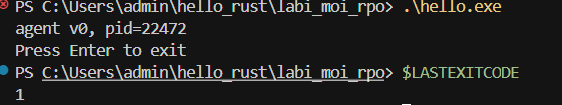
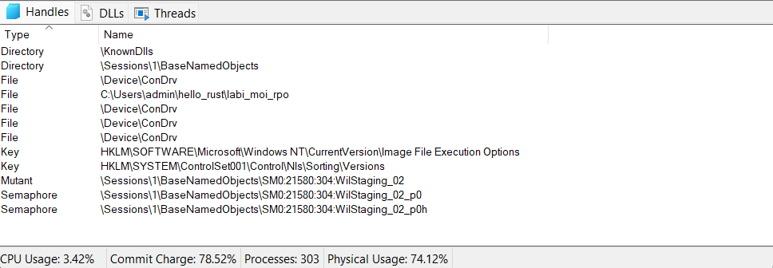

# ЛР 1. Процесс изнутри

Система: ___ · компилятор: ___ (первая строка вывода версии)

## Программа на C
Программа напечатала PID ___, монитор показал PID ___.
Память процесса в мониторе: ___. Процессорное время: ___.
Пока программа ждёт Enter, процессорное время не растёт, потому что ___.
Дескрипторов у процесса: ___. Ввод и вывод ведут в ___.
Системные библиотеки в процессе: ___.
После завершения из монитора терминал напечатал ___, код завершения ___.

## Программа на Python
Имя процесса в мониторе: ___, PID ___, память ___.
Памяти больше, чем у программы на C, примерно в ___ раз.
Общая библиотека у программ на C и Python: ___.
Код завершения при обычном выходе: ___.

Не получилось: ___

## Наблюдения на компьютере студента (Windows 11)

Источник: скриншот вкладки «Подробности» Диспетчера задач Windows 11, предоставленный студентом в чате. Наблюдения относятся к реально запущенному `hello.exe`, а не к GitHub Actions.

| Параметр | Наблюдаемое значение |
|---|---|
| Имя процесса | `hello.exe` |
| PID | `18372` |
| Состояние | Выполняется |
| CPU | 00% (отображаемое значение) |
| CPU time | `0:00:00` |
| Отображаемое значение памяти | `3 648 КБ` (тип столбца требует подтверждения) |
| Ещё один столбец памяти | `308 КБ` (тип столбца требует подтверждения) |
| Дескрипторы | `46` |
| Архитектура | x64 |

Процесс ожидал ввода пользователя; практически нулевое процессорное время согласуется с блокирующим ожиданием ввода, а не активным циклом. Точные названия двух столбцов памяти предстоит подтвердить по заголовкам таблицы. Снимок из переписки ещё не помещён в `screenshots/`.

## Наблюдение Python на компьютере студента (Windows 11)

Источник: второй скриншот вкладки «Подробности» Диспетчера задач, полученный в чате; реальный запущенный `python3.12.exe`.

| Параметр | C (`hello.exe`) | Python (`python3.12.exe`) |
|---|---:|---:|
| PID | 18372 | 22896 |
| Состояние | Выполняется | Выполняется |
| CPU (отображаемый) | 00 | 00 |
| CPU time | 0:00:00 | 0:00:00 |
| Первый показатель памяти | 3 648 КБ | 21 276 КБ |
| Второй показатель памяти | 308 КБ | 4 796 КБ |
| Дескрипторы | 46 | 255 |
| Архитектура | x64 | x64 |

По **первому** показателю памяти отношение Python/C = `21276/3648 ≈ 5,83`; по второму — `4796/308 ≈ 15,57`. Точные заголовки столбцов обоих показателей памяти на присланных скриншотах не видны, поэтому их типы **не подтверждены**. Название процесса в Диспетчере задач — `python3.12.exe`; PID из консольного вывода самого `hello.py` отдельно не показан. Скриншоты из чата пока не добавлены в папку `screenshots/`.

## Подтверждённые результаты и анализ (Windows CI)

Проверка [Windows lab code checks](https://github.com/tayoutodie/labi_moi_rpo/actions/runs/44279028814) на **Windows Server 2025** (не на домашней Windows 11) выполнена успешно: MSVC (`cl`) собрал `hello.c`, а Python 3.13.17 запустил `hello.py`.

- Вывод C в CI: `agent v0, pid=7696`.
- Вывод Python в CI: `agent v0 (python), pid=9120`.
- Обе проверки: **PASS**. Это номера процессов CI и они не являются PID на ПК студента.
- Почему ожидание Enter не расходует заметного CPU: поток блокируется на вводе, а не непрерывно выполняет цикл.
- При обычном завершении программа возвращает 0; завершение диспетчером задач может иметь другой код.
- Python обычно потребляет больше памяти из-за интерпретатора, объектов и загруженных модулей. Точную кратность необходимо **измерить**, а не угадывать.

**Осталось измерить на Windows 11:** PID и память обеих программ в диспетчере задач, CPU time, открытые дескрипторы и DLL (удобно через Process Explorer), результат принудительного завершения и сравнение объёма памяти. Сделать 8 снимков из раздела ниже.

## Снимки экрана

Сохраните снимок поверх заглушки в папке `screenshots/` с тем же именем — ссылки ниже менять не нужно.

### 1. Программа на C запущена
Шаг 1. Видно: команда сборки и строка `agent v0, pid=…` в терминале.

### 2. Свой процесс в мониторе
Шаг 3. Видно: строка процесса `hello` с тем же номером, что напечатала программа.

### 3. Свойства процесса
Шаг 4. Видно: окно процесса `hello`: номер, память, процессорное время.

### 4. Дескрипторы процесса
Шаг 5. Видно: открытые файлы или дескрипторы: папка программы и устройство терминала.

### 5. Библиотеки процесса
Шаг 6. Видно: загруженные библиотеки (в Linux — карта памяти).

### 6. Процесс завершён из монитора
Шаг 8. Видно: терминал после завершения: сообщение оболочки и код завершения.

### 7. Программа на Python в мониторе
Шаг 9. Видно: строка `agent v0 (python), pid=…` и процесс Python с тем же номером.

### 8. Обычный выход
Шаг 11. Видно: терминал после Enter: код завершения 0.

