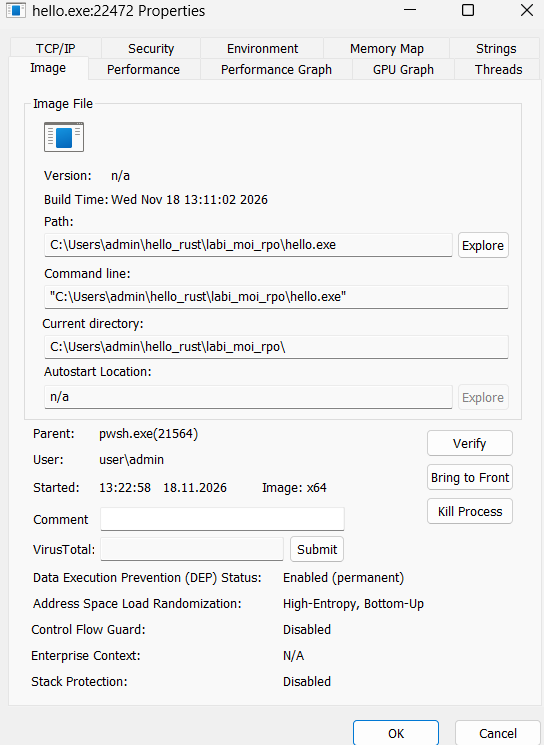
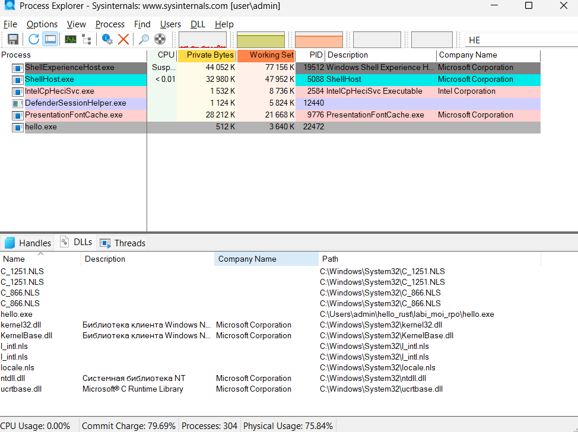
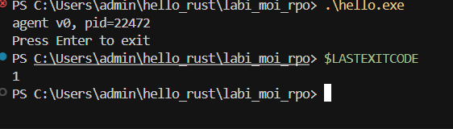
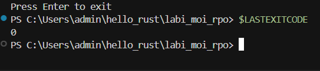

# ЛР 1. Процесс изнутри

Система: **Windows 11 x64** · компилятор: **GCC 16.2.0 (MSYS2 UCRT64)**.

## Программа на C
Программа напечатала PID **22472** (в повторном запуске), Process Explorer показал **22472**. В первом запуске Диспетчер задач показывал PID **18372**.
Память первого запуска: **3 648 КБ** (первый столбец памяти, заголовок не подтверждён), **308 КБ** (второй столбец); CPU time **0:00:00**. Для повторного запуска Process Explorer: **Working Set 3 640 КБ**, **Private Bytes 512 КБ**.
Во время ожидания Enter поток блокируется на вводе и почти не использует CPU.
Дескрипторов в первом запуске: **46**; в другом снимке видны File (консоль `\\Device\\ConDrv` и каталог проекта), Directory, Key, Mutant, Semaphore.
Загруженные DLL: **kernel32.dll**, **KernelBase.dll**, **ntdll.dll**, **ucrtbase.dll**.
После принудительного завершения из Process Explorer `$LASTEXITCODE` показал **1**.

## Программа на Python
Имя процесса: **python3.12.exe**, PID **22896**. Первый показатель памяти **21 276 КБ**, второй **4 796 КБ**, дескрипторов **255**.
По первому столбцу памяти отношение Python/C: **21 276 / 3 648 ≈ 5,83 раза**; точный тип этого столбца не подтверждён.
Общая наблюдаемая DLL: **kernel32.dll** (также `KernelBase.dll` и `ntdll.dll`).
Код завершения при обычном выходе после Enter: **0**.

Не получилось / замечания: названия двух столбцов памяти на первоначальных кадрах не видны; часть скриншотов недостаточно полно показывает требуемый контекст.

## Статус подтверждений

Данные разделов выше получены на Windows 11 студента, если прямо не обозначено CI. Результаты CI на Windows Server 2025 приведены отдельно и не заменяют локальные наблюдения. Некоторые кадры в `screenshots/` могут быть повторными или неполными; наличие файла не означает, что все требования экспериментально выполнены. Отсутствующие измерения обозначены явно.

## Наблюдения на компьютере студента (Windows 11)

Источник: скриншот вкладки «Подробности» Диспетчера задач Windows 11, предоставленный студентом в чате. Наблюдения относятся к реально запущенному `hello.exe`, а не к GitHub Actions.

| Параметр | Наблюдаемое значение |
|---|---|
| Имя процесса | `hello.exe` |
| PID | `18372` |
| Состояние | Выполняется |
| CPU | 00% (отображаемое значение) |
| CPU time | `0:00:00` |
| Отображаемое значение памяти | `3 648 КБ` (тип столбца требует подтверждения) |
| Ещё один столбец памяти | `308 КБ` (тип столбца требует подтверждения) |
| Дескрипторы | `46` |
| Архитектура | x64 |

## Наблюдение Python на компьютере студента (Windows 11)

Источник: второй скриншот вкладки «Подробности» Диспетчера задач, полученный в чате; реальный запущенный `python3.12.exe`.

| Параметр | C (`hello.exe`) | Python (`python3.12.exe`) |
|---|---:|---:|
| PID | 18372 | 22896 |
| Состояние | Выполняется | Выполняется |
| CPU (отображаемый) | 00 | 00 |
| CPU time | 0:00:00 | 0:00:00 |
| Первый показатель памяти | 3 648 КБ | 21 276 КБ |
| Второй показатель памяти | 308 КБ | 4 796 КБ |
| Дескрипторы | 46 | 255 |
| Архитектура | x64 | x64 |

По **первому** показателю памяти отношение Python/C = `21276/3648 ≈ 5,83`; по второму — `4796/308 ≈ 15,57`. Точные заголовки столбцов обоих показателей памяти на присланных 

## Обычное завершение Python на Windows 11

Студент нажал Enter в терминале Cursor после запуска `hello.py` и выполнил PowerShell-команду `$LASTEXITCODE`. На предоставленном скриншоте получено **`0`**. Это подтверждает штатное завершение процесса Python. Наблюдение выполнено на Windows 11 студента, а не в GitHub Actions.

## Дополнительное наблюдение в Process Explorer (Windows 11)

По скриншоту вкладки **Properties → Image** для следующего запуска `hello.exe`:

- PID процесса: **22472**; родитель: **pwsh.exe**, PID родителя **21564**.
- Архитектура: **x64**; время запуска: **18.11.2026 13:22:58**.
- DEP: **Enabled (permanent)**; ASLR: **High-Entropy, Bottom-Up**.
- Программа запущена из каталога проекта в терминале PowerShell. Точный путь показан на снимке; в публичный отчёт персональный локальный путь не копируется.
- **Список DLL пока не зафиксирован**: вкладка Image не показывает полный перечень модулей. Нужен Lower Pane → DLLs (Ctrl+D).

Этот PID принадлежит **новому запуску** и отличается от PID 18372 на предыдущем снимке.

## Загруженные библиотеки и память (Process Explorer, Windows 11)

Источник: скриншот главного окна Process Explorer с открытой нижней панелью **DLLs**, предоставленный студентом. Выбран процесс `hello.exe`, PID **22472**.

| Показатель | Значение |
|---|---:|
| Private Bytes | 512 КБ |
| Working Set | 3 640 КБ |
| Загрузка CPU | 0% |

В списке реально отображаются системные DLL: `kernel32.dll`, `KernelBase.dll`, `ntdll.dll`, `ucrtbase.dll` (путь `C:\\Windows\\System32\\`). Также видны файлы `.NLS` и сам `hello.exe`; файлы NLS не являются DLL. Значения памяти относятся к **новому запуску PID 22472** и потому могут немного отличаться от предыдущего наблюдения PID 18372.

Этот кадр подтверждает наличие четырёх DLL в отображённом списке, но не является доказательством полного перечня модулей, если есть прокрутка. 
## Принудительное завершение процесса (Windows 11)

Источник: 
Это подтверждает, что PowerShell получил ненулевой код завершения `1` для данного принудительно остановленного запуска. Для сравнения, нормальное завершение `hello.py` нажатием Enter дало `0`. Значения принадлежат разным программам/запускам; их нельзя обобщать как обязательные коды для всех способов завершения в Windows.

## Дескрипторы в Process Explorer (Windows 11)

По скриншоту нижней панели **Handles** Process Explorer, предоставленному студентом, в отображаемой части списка видно **13 строк** дескрипторов. Это число строк на кадре, **не** полное количество дескрипторов процесса.

| Тип | Фактически видимые объекты |
|---|---|
| Directory | `\\KnownDlls`, `\\Sessions\\1\\BaseNamedObjects` |
| File | `\\Device\\ConDrv` (несколько строк), каталог проекта |
| Key | разделы реестра `HKLM\\SOFTWARE\\Microsoft\\Windows NT\\CurrentVersion\\Image File Execution Options` и `HKLM\\SYSTEM\\ControlSet001\\Control\\Nls\\Sorting\\Versions` |
| Mutant | объект синхронизации `\\Sessions\\1\\BaseNamedObjects\\SM0:21580:304:WiStaging_02` |
| Semaphore | два объекта `WiStaging_02_p0`, `WiStaging_02_p0h` |

При первом наблюдении `hello.exe` в Диспетчере задач был отдельный счётчик **46 дескрипторов** (PID 18372), который нельзя заменять количеством видимых строк текущего снимка. На снимке Handles заголовок процесса/PID не виден; студент прислал кадр в ходе исследования нового запуска `hello.exe`. 
## Подтверждённые результаты и анализ (Windows CI)

Проверка [Windows lab code checks](https://github.com/tayoutodie/labi_moi_rpo/actions/runs/44279028814) на **Windows Server 2025** (не на домашней Windows 11) выполнена успешно: MSVC (`cl`) собрал `hello.c`, а Python 3.13.17 запустил `hello.py`.

- Вывод C в CI: `agent v0, pid=7696`.
- Вывод Python в CI: `agent v0 (python), pid=9120`.
- Обе проверки: **PASS**. Это номера процессов CI и они не являются PID на ПК студента.
- Почему ожидание Enter не расходует заметного CPU: поток блокируется на вводе, а не непрерывно выполняет цикл.
- При обычном завершении программа возвращает 0; завершение диспетчером задач может иметь другой код.
- Python обычно потребляет больше памяти из-за интерпретатора, объектов и загруженных модулей. Точную кратность необходимо **измерить**, а не угадывать.

## Снимки экрана

Сохраните снимок поверх заглушки в папке `screenshots/` с тем же именем — ссылки ниже менять не нужно.

### 1. Программа на C запущена
Шаг 1. Видно: команда сборки и строка `agent v0, pid=…` в терминале.

### 2. Свой процесс в мониторе
Шаг 3. Видно: строка процесса `hello` с тем же номером, что напечатала программа.

### 3. Свойства процесса
Шаг 4. Видно: окно процесса `hello`: номер, память, процессорное время.

### 4. Дескрипторы процесса
Шаг 5. Видно: открытые файлы или дескрипторы: папка программы и устройство терминала.

### 5. Библиотеки процесса
Шаг 6. Видно: загруженные библиотеки (в Linux — карта памяти).

### 6. Процесс завершён из монитора
Шаг 8. Видно: терминал после завершения: сообщение оболочки и код завершения.

### 7. Программа на Python в мониторе
Шаг 9. Видно: строка `agent v0 (python), pid=…` и процесс Python с тем же номером.

### 8. Обычный выход
Шаг 11. Видно: терминал после Enter: код завершения 0.

