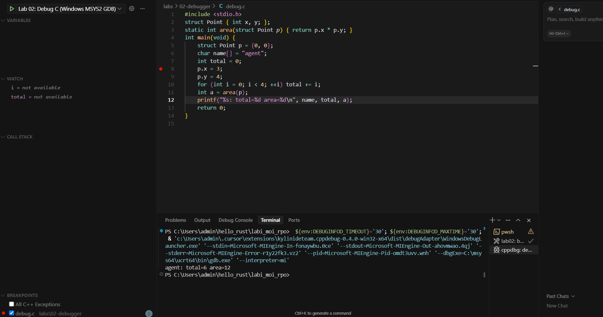
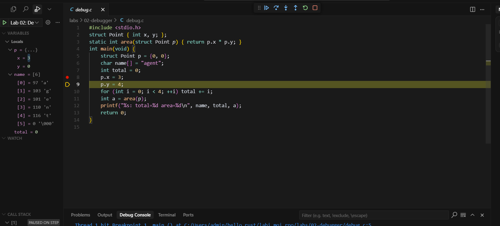
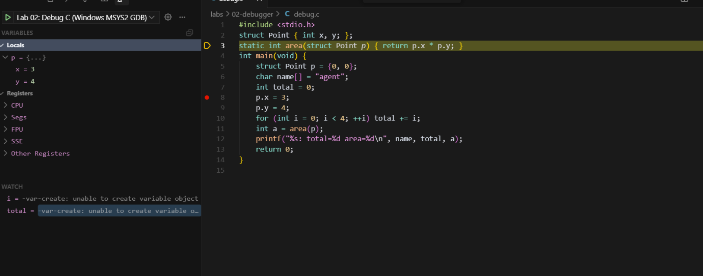

# ЛР 2. Программа в отладчике

Система: **Windows 11 x64** · компилятор: **GCC/MSYS2**, отладчик: **GDB в Cursor (cppdbg)**.

## Остановка и переменные
Программа напечатала: **`agent: total=6 area=12`**.
Breakpoint: **строка 8 (`p.x = 3;`)** в фактическом `debug.c`.
Перед выполнением `p.x = 3;`: **p.x=0, p.y=0, total=0** (инициализация по коду; снимок до присваивания не раскрывает поля `p`).
После F10 на строке 9: **p.x=3, p.y=0, total=0**; после следующего присваивания: **p.x=3, p.y=4**.
Шаг F10 (**Step Over**) не заходит внутрь функции, тогда как F11 (**Step Into**) заходит; буквальные номера строк 15/16 из исходного учебного задания не соответствуют компактному исходнику.
Массив `name`: `name[0] = 97 ('a')`, `name[5] = 0 ('\\0')`.

## Цикл и функция
На остановке после цикла: **total=6**. Значение `i` недоступно, поскольку после цикла оно вышло из области видимости; значения на конкретной итерации **не снимались**.
В стеке GDB видны два кадра пользовательского кода: сверху **area(struct Point p)**, ниже **main()**.
Машинная инструкция умножения: **`imul %edx,%eax`** (AT&T syntax).
Итоговое **a=12** подтверждено выводом программы, **total=6** показано в Variables до вызова `area`. Отдельного кадра с `a` непосредственно перед `printf` нет.
Код штатного завершения: **0**.

Не получилось / замечания: отдельный кадр WATCH с числовыми `i` и `total` во время цикла не получен; в `05_watch_loop.png` WATCH показывает недоступные переменные.

## Статус подтверждений

Данные разделов выше получены на Windows 11 студента, если прямо не обозначено CI. Результаты CI на Windows Server 2025 приведены отдельно и не заменяют локальные наблюдения. Некоторые кадры в `screenshots/` могут быть повторными или неполными; наличие файла не означает, что все требования экспериментально выполнены. Отсутствующие измерения обозначены явно.

## Реальное пошаговое наблюдение в Cursor / GDB (Windows 11)

Источник: скриншот Cursor от студента с остановкой на строке `p.y = 4;` после **F10 (Step Over)** строки `p.x = 3;`.

| Данные в Variables | Наблюдение |
|---|---|
| Текущая строка | 9 — `p.y = 4;` (ещё не выполнена) |
| `p.x` | **3** |
| `p.y` | **0** |
| `total` | **0** |
| `name` | массив из 6 элементов, `agent\\0` |
| `name[0]` | **97** — `a` |
| `name[1]` | **103** — `g` |
| `name[2]` | **101** — `e` |
| `name[3]` | **110** — `n` |
| `name[4]` | **116** — `t` |
| `name[5]` | **0** — завершающий нуль |

Точка останова установлена на строке 8. Шаг через присваивание `p.x` успешно выполнен; присваивание `p.y` ещё ожидает исполнения. 
## Наблюдение после выполнения цикла (Cursor/GDB, Windows 11)

По присланному студентом 
Для `i` в WATCH показано `-var-create: unable to create variable object`, потому что локальная переменная цикла `for (int i = 0; ...)` вне области видимости после окончания цикла. Математическая сумма итераций: `0 + 1 + 2 + 3 = 6`. По этому снимку нельзя установить значения `i` и `total` **на втором проходе цикла** — для этого потребуется остановка внутри `for`. 
## Наблюдение внутри функции area (Cursor/GDB, Windows 11)

Источник: скриншот Cursor после F11 (Step Into) с остановкой в функции `area(struct Point p)` на строке **3** файла `debug.c`.

- В панели Locals развёрнута копия структуры `p`: **x = 3**, **y = 4**.
- На этой строке вычисляется выражение `p.x * p.y`, ожидаемое значение возвращаемого результата — **12**. Сам возврат ещё не показан на этом снимке.
- В Watch выражения `i` и `total` недоступны в текущем кадре функции, поскольку они локальные в `main` (а `i` ещё и выходит из области видимости после цикла).
- Панель Call Stack **не видна на присланном кадре**; для подтверждения двух уровней `area()` и `main()` требуется отдельный снимок с открытой панелью.
- Изображение пока существует только в переписке и не внесено в `screenshots/` GitHub.

## Реальный стек вызовов GDB (Windows 11)

На присланном скриншоте Cursor в панели **CALL STACK** для остановленного потока `[1]` отображаются два кадра пользовательского кода:

1. `area(struct Point p)`, `debug.c:3` — текущий кадр; в **VARIABLES → Locals**: `p.x = 3`, `p.y = 4`.
2. `main()`, `debug.c:11` — вызывающая функция, ожидает результата `area(p)`.

Остановка помечена `PAUSED ON STEP`. Ниже отображаются и другие потоки/системные кадры `ntdll.dll` и `kernel32.dll`, но они не входят в два кадра вызова `main → area`. Этот кадр соответствует пункту `06_call_stack.png` и находится в репозитории. Результат умножения `12` пока не подтверждён непосредственно выводом регистра или исполненным возвратом на данном снимке.

## Дизассемблирование функции area — реальное наблюдение (Windows 11)

На предоставленном студентом 
```asm
mov 0x10(%rbp),%edx
mov 0x14(%rbp),%eax
imul %edx,%eax
pop %rbp
ret
```

- Инструкция **`imul %edx,%eax`**, по дизассемблированию — `area+14`, выполняет умножение двух целых чисел с записью результата в EAX.
- С учётом наблюдённых значений `p.x = 3` и `p.y = 4` вычисляемый результат должен быть **12**. На данном снимке фактическое значение `a` после возврата ещё не наблюдалось.
- Вызовы `area(struct Point p)` и `main()` показаны в CALL STACK.
- 
## Завершение отладки (Windows 11, реальное наблюдение)

На присланном 
- `[Inferior 1 (process 8628) exited normally]`;
- `debug.exe has exited with code 0 (0x00000000)`.


## Подтверждённый вывод программы в терминале Cursor (Windows 11)

Студент предоставил скриншот терминала Cursor после запуска программы под GDB. Видна фактическая строка стандартного вывода:

```text
agent: total=6 area=12
```

Это подтверждает результат вычисления `total=6` и `area=12` именно на компьютере с Windows 11. На предыдущем 
## Подтверждённые результаты и анализ (Windows CI)

[Автопроверка Windows](https://github.com/tayoutodie/labi_moi_rpo/actions/runs/44279028814) **PASS**: программа `debug.c` собрана MSVC с отладочными символами `/Zi`, а консольный вывод — `agent: total=6 area=12`. Это подтверждает сборку и выполнение, **не** прохождение через отладчик.

По текущему исходнику `debug.c` ожидаемая логика:
- `p` начинает с координат 0,0; затем `p.x=3`, `p.y=4`.
- `name` содержит `a g e n t \0`; ASCII-код `a` равен 97; `name[5]=0`.
- Цикл суммирует `0+1+2+3=6`, функция `area` возвращает `3*4=12`.
- Внутри `area` стек вызовов должен включать `area` и `main`. В текущем запуске GDB наблюдалась инструкция `imul %edx,%eax`.

**Важно:** в опубликованной версии `debug.c` номера строк отличаются от исходной пошаговой инструкции преподавателя. Ставьте точки остановки на самих операторах присваивания, цикле и `return`, а не полагайтесь на фиксированный номер 15. Нужно реально пройти F9/F10/F11 в Visual Studio, посмотреть Variables, Watch, Call Stack, Disassembly и сохранить 8 скриншотов.

## Снимки экрана

Сохраните снимок поверх заглушки в папке `screenshots/` с тем же именем — ссылки ниже менять не нужно.

### 1. Сборка и запуск без отладчика
Шаг 1. Видно: команда сборки и строка `agent: total=6 area=12`.



### 2. Точка останова
Шаг 3. Видно: красная точка у строки 15 и она же в списке Breakpoints.


### 3. Остановка перед строкой 15
Шаг 4. Видно: жёлтая стрелка у строки 15, переменные в Variables до присваивания.


### 4. Массив name по ячейкам
Шаг 6. Видно: раскрытый `name`: буквы `agent` и ноль в `[5]`.



### 5. Цикл в Watch
Шаг 7. Видно: `i` и `total` в разделе Watch на втором проходе цикла.



### 6. Внутри функции area
Шаг 8. Видно: стрелка в `area`, копия `p` в Variables, две строки в Call Stack.


### 7. Машинный код строки 10
Шаг 9. Видно: вкладка Disassembly с командой умножения.


### 8. Программа доработала
Шаг 11. Видно: вывод программы под отладчиком и код завершения.


