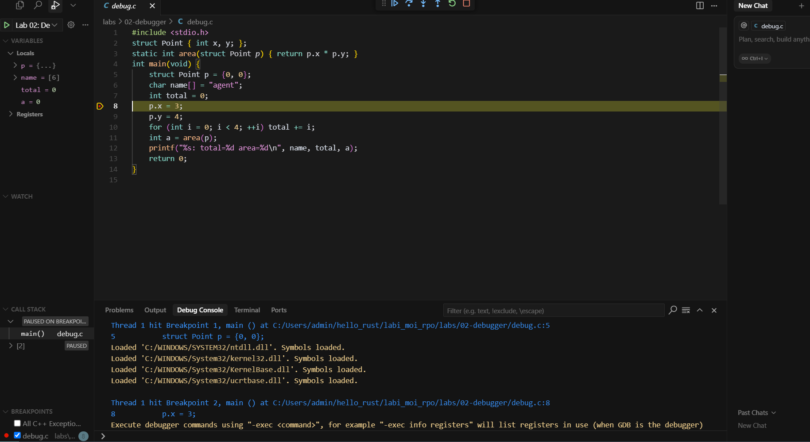
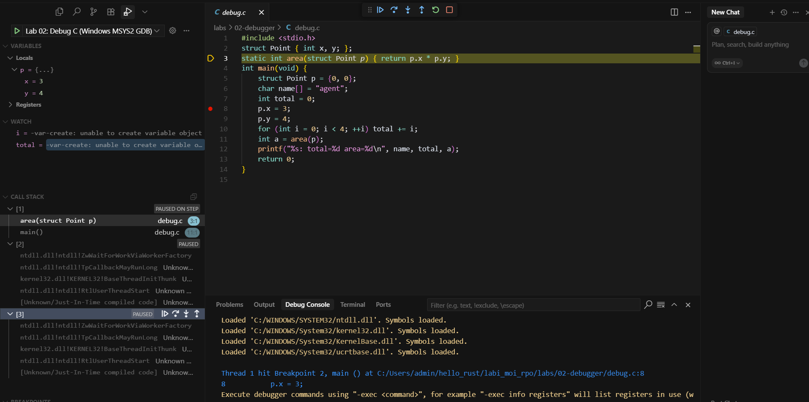
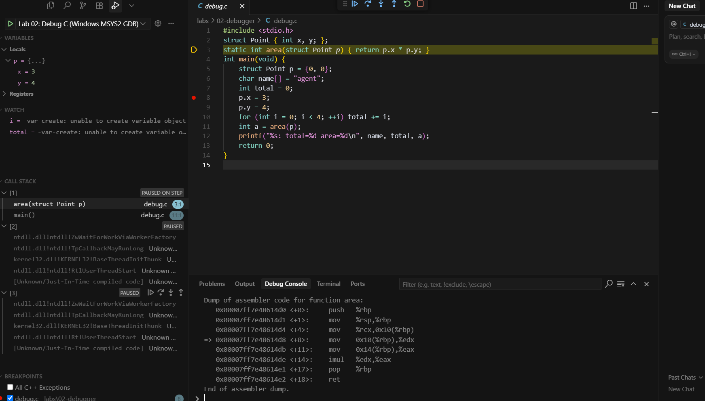
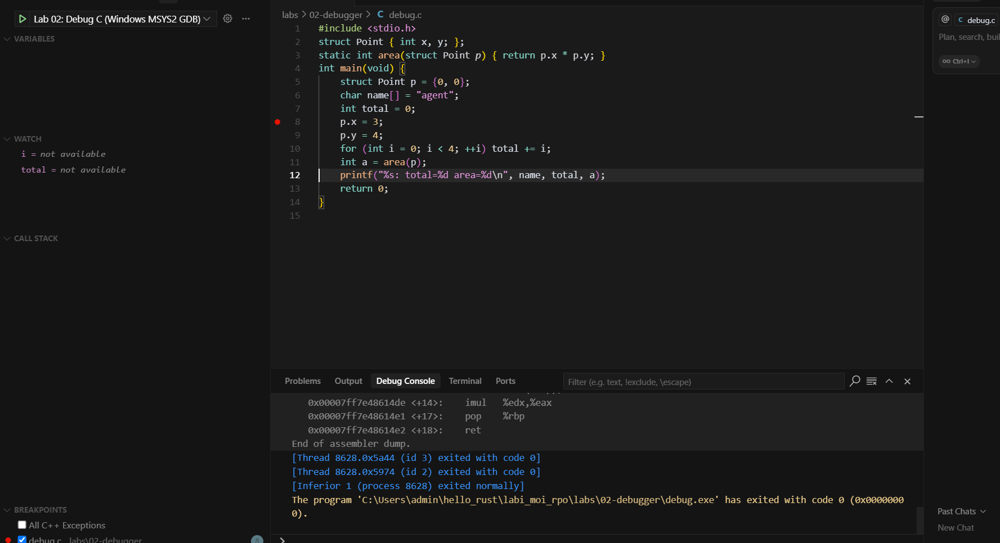

# ЛР 2. Программа в отладчике

Система: ___ · отладчик: ___ (LLDB, GDB или Visual Studio)

## Остановка и переменные
Программа без отладчика напечатала: ___
Точка останова на строке ___.
До строки 15: p.x = ___, p.y = ___, total = ___.
После строки 15: p.x = ___, p.y = ___.
Строку 16 отладчик пропустил, потому что ___.
name[0] = ___ (код буквы), завершающий ноль в ячейке ___.

## Цикл и функция
На кадре цикла: i = ___, total = ___; после следующего шага total = ___.
В стеке внутри area строк: ___, сверху функция ___.
Команда умножения в машинном коде: ___.
Перед printf: a = ___, total = ___.
Код завершения программы: ___.

Не получилось: ___

## Реальное пошаговое наблюдение в Cursor / GDB (Windows 11)

Источник: скриншот Cursor от студента с остановкой на строке `p.y = 4;` после **F10 (Step Over)** строки `p.x = 3;`.

| Данные в Variables | Наблюдение |
|---|---|
| Текущая строка | 9 — `p.y = 4;` (ещё не выполнена) |
| `p.x` | **3** |
| `p.y` | **0** |
| `total` | **0** |
| `name` | массив из 6 элементов, `agent\\0` |
| `name[0]` | **97** — `a` |
| `name[1]` | **103** — `g` |
| `name[2]` | **101** — `e` |
| `name[3]` | **110** — `n` |
| `name[4]` | **116** — `t` |
| `name[5]` | **0** — завершающий нуль |

Точка останова установлена на строке 8. Шаг через присваивание `p.x` успешно выполнен; присваивание `p.y` ещё ожидает исполнения. Скриншот из переписки пока не перенесён в каталог `screenshots/` репозитория. Наблюдение относится к реальному запуску на Windows 11, а не к GitHub Actions.

## Наблюдение после выполнения цикла (Cursor/GDB, Windows 11)

По присланному студентом скриншоту Cursor отладчик остановлен **перед строкой 11** `int a = area(p);`. В Variables видно `p.x = 3`, `p.y = 4`, `total = 6`; массив `name` содержит `agent\\0`. В WATCH выражение `total` показывает **6**.

Для `i` в WATCH показано `-var-create: unable to create variable object`, потому что локальная переменная цикла `for (int i = 0; ...)` вне области видимости после окончания цикла. Математическая сумма итераций: `0 + 1 + 2 + 3 = 6`. По этому снимку нельзя установить значения `i` и `total` **на втором проходе цикла** — для этого потребуется остановка внутри `for`. Скриншот из чата пока не сохранён в каталоге `screenshots/`.

## Подтверждённые результаты и анализ (Windows CI)

[Автопроверка Windows](https://github.com/tayoutodie/labi_moi_rpo/actions/runs/44279028814) **PASS**: программа `debug.c` собрана MSVC с отладочными символами `/Zi`, а консольный вывод — `agent: total=6 area=12`. Это подтверждает сборку и выполнение, **не** прохождение через отладчик.

По текущему исходнику `debug.c` ожидаемая логика:
- `p` начинает с координат 0,0; затем `p.x=3`, `p.y=4`.
- `name` содержит `a g e n t \0`; ASCII-код `a` равен 97; `name[5]=0`.
- Цикл суммирует `0+1+2+3=6`, функция `area` возвращает `3*4=12`.
- Внутри `area` стек вызовов должен включать `area` и `main`. Конкретная ассемблерная инструкция зависит от компилятора и архитектуры и пока не наблюдалась.

**Важно:** в опубликованной версии `debug.c` номера строк отличаются от исходной пошаговой инструкции преподавателя. Ставьте точки остановки на самих операторах присваивания, цикле и `return`, а не полагайтесь на фиксированный номер 15. Нужно реально пройти F9/F10/F11 в Visual Studio, посмотреть Variables, Watch, Call Stack, Disassembly и сохранить 8 скриншотов.

## Снимки экрана

Сохраните снимок поверх заглушки в папке `screenshots/` с тем же именем — ссылки ниже менять не нужно.

### 1. Сборка и запуск без отладчика
Шаг 1. Видно: команда сборки и строка `agent: total=6 area=12`.

### 2. Точка останова
Шаг 3. Видно: красная точка у строки 15 и она же в списке Breakpoints.

### 3. Остановка перед строкой 15
Шаг 4. Видно: жёлтая стрелка у строки 15, переменные в Variables до присваивания.

### 4. Массив name по ячейкам
Шаг 6. Видно: раскрытый `name`: буквы `agent` и ноль в `[5]`.

### 5. Цикл в Watch
Шаг 7. Видно: `i` и `total` в разделе Watch на втором проходе цикла.

### 6. Внутри функции area
Шаг 8. Видно: стрелка в `area`, копия `p` в Variables, две строки в Call Stack.

### 7. Машинный код строки 10
Шаг 9. Видно: вкладка Disassembly с командой умножения.

### 8. Программа доработала
Шаг 11. Видно: вывод программы под отладчиком и код завершения.

