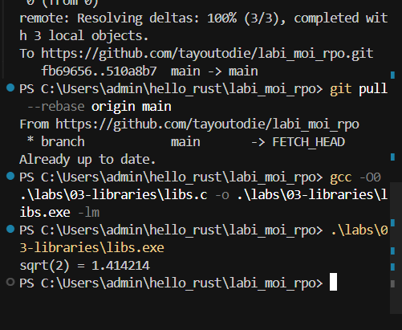
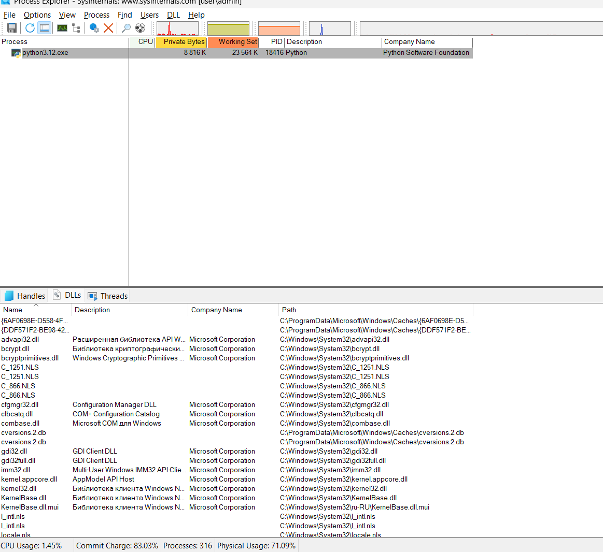

# ЛР 3. Библиотеки программы

Система: ___

## Библиотеки файла
Программа напечатала: ___
Команда для списка библиотек файла: ___
Библиотеки libs: ___
Почему в списке нет отдельной математической библиотеки (или почему она есть): ___
Где лежит интерпретатор Python (файл или библиотека): ___

## Библиотеки процесса
PID Python: ___
Библиотек в процессе до ctypes.CDLL: ___, после: ___
Загруженная библиотека и её полный путь: ___
Функция вернула: ___

Не получилось: ___

## Реальные измерения на Windows 11 — шаги 1–2

Источник: два скриншота терминала Cursor, предоставленные студентом 18.11.2026.

**Сборка и выполнение:** команда `gcc -O0 .\\labs\\03-libraries\\libs.c -o .\\labs\\03-libraries\\libs.exe -lm` завершилась без видимых ошибок. При запуске `libs.exe` получено:

```text
sqrt(2) = 1.414214
```

**Импортируемые DLL:** команда `C:\\msys64\\ucrt64\\bin\\objdump.exe -p .\\labs\\03-libraries\\libs.exe | Select-String "DLL Name"` показала:

```text
KERNEL32.dll
api-ms-win-crt-environment-l1-1-0.dll
api-ms-win-crt-heap-l1-1-0.dll
api-ms-win-crt-locale-l1-1-0.dll
api-ms-win-crt-math-l1-1-0.dll
api-ms-win-crt-private-l1-1-0.dll
api-ms-win-crt-runtime-l1-1-0.dll
api-ms-win-crt-stdio-l1-1-0.dll
api-ms-win-crt-string-l1-1-0.dll
```

Итого **9 записей импорта DLL**. Это имена импортов PE-файла, а не полный перечень реально загруженных модулей процесса. Запись `api-ms-win-crt-math-l1-1-0.dll` относится к математическому API набора Universal CRT; отдельной `libm.dll` в списке нет. Скриншоты ещё не перенесены в папку `screenshots/` GitHub.

## Реальное наблюдение Python в Process Explorer (Windows 11)

Источник: скриншот Process Explorer, предоставленный студентом (после запуска интерактивного Python).

| Показатель | Фактическое значение |
|---|---:|
| Процесс | `python3.12.exe` |
| PID | **18416** |
| Private Bytes | **8 816 КБ** |
| Working Set | **23 564 КБ** |

В нижней панели DLLs видны `advapi32.dll`, `bcrypt.dll`, `bcryptprimitives.dll`, `cfgmgr32.dll`, `combase.dll`, `gdi32.dll`, `kernel32.dll`, `KernelBase.dll` и другие системные модули. Полный список и его количество **не определяются** по частичному скриншоту (панель прокручивается).

Также студент ранее установил по результатам `sys.base_prefix`, что локальный Python 3.12.10 использует каталог пакета Microsoft Store с библиотеками `python3.dll` и `python312.dll`; полный путь содержит персональные данные и здесь не воспроизводится. Снимок пока находится в переписке и не добавлен в `screenshots/`.

## Измерение числа DLL до и после загрузки (Windows 11)

Источник: два скриншота терминала PowerShell, присланные студентом. Наблюдается процесс Python **PID 18416**.

| Измерение | Результат |
|---|---|
| Команда подсчёта | `(Get-Process -Id 18416 -Module | Where-Object ModuleName -like "*.dll").Count` |
| Число DLL до | **36** |
| Число DLL после | **39** |
| Прирост | **3 DLL** |
| Модуль, обнаруженный после | `winmm.dll` |
| Полный путь | `C:\\WINDOWS\\SYSTEM32\\winmm.dll` |

Для поиска модуля использована команда `Get-Process -Id 18416 -Module | Where-Object ModuleName -like "winmm.dll" | Select-Object ModuleName,FileName`. Разница 39 − 36 = 3 подтверждена показанными результатами команды в PowerShell; **не утверждаем**, что все три DLL непосредственно загружены одной командой: возможны транзитивные зависимости и другие загрузки. Строка вызова `ctypes.CDLL("winmm.dll")` и результат `timeGetTime()` на этих двух снимках **не видны**, их нужно подтвердить отдельным кадром. Изображения пока находятся в переписке и ещё не добавлены в `screenshots/` GitHub.

## Подтверждённые результаты и анализ (Windows CI)

[Автопроверка Windows](https://github.com/tayoutodie/labi_moi_rpo/actions/runs/44279028814): сборка `libs.c` через MSVC и запуск **PASS**, вывод: `sqrt(2) = 1.414214`.

Ожидаемое объяснение: `sqrt` вызывается через доступную реализацию математических функций C; на Windows зависимости PE-файла показывают `dumpbin /dependents`, а загруженные в процесс DLL можно посмотреть в Process Explorer / Process Monitor. Отдельная DLL `libm` в Windows не обязательна — математическая функция может находиться в C runtime.

**Не проверено:** фактический список DLL у локальной программы и интерпретатора Python, количество модулей до/после `ctypes.CDLL`, точный путь DLL и результат вызова функции. Их нужно получить из реального процесса на Windows 11 и добавить 7 снимков.

## Снимки экрана

Сохраните снимок поверх заглушки в папке `screenshots/` с тем же именем — ссылки ниже менять не нужно.

### 1. Сборка и запуск
Шаг 1. Видно: команда сборки и строка `sqrt(2) = 1.414214`.



### 2. Библиотеки файла libs
Шаг 2. Видно: вывод `dumpbin /dependents` / `otool -L` / `ldd` для своей программы.


### 3. Библиотеки интерпретатора Python
Шаг 3. Видно: тот же вывод для файла Python.


### 4. Номер процесса Python
Шаг 4. Видно: запущенный Python и его номер процесса.



### 5. Библиотеки процесса до загрузки
Шаг 5. Видно: число библиотек процесса Python до `ctypes.CDLL`.


### 6. Библиотека загружена
Шаг 6. Видно: строка `ctypes.CDLL` и результат вызова функции библиотеки.


### 7. Библиотеки процесса после загрузки
Шаг 7. Видно: новое число библиотек и строка загруженной библиотеки.


