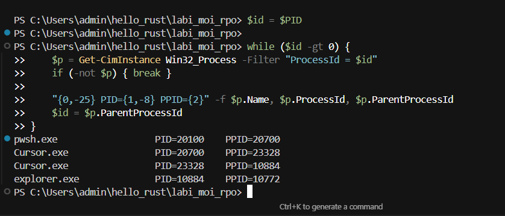

# ЛР 4. Дерево процессов

Система: **Windows 11 x64**. Метод: PowerShell, `Get-CimInstance Win32_Process` (графический режим дерева Process Explorer оказался недоступен).

## Дерево
Системный процесс **System, PID 4, PPID 0**. Другие реально найденные: `smss.exe` PID 688 (PPID 4), `wininit.exe` PID 1060 (PPID 824), `services.exe` PID 1208 (PPID 1060).
Цепочка терминала снизу вверх: **pwsh.exe (20100) ← Cursor.exe (20700) ← Cursor.exe (23328) ← explorer.exe (10884)**; выше у Explorer записан PPID **10772**, но процесс с ним не найден.
Дочерний процесс: **cmd.exe PID 20788**, родитель **pwsh.exe PID 20100**.
Команда: `Get-CimInstance Win32_Process -Filter "ProcessId = $($child.Id)" | Select-Object Name,ProcessId,ParentProcessId`.
Браузер: **33 процесса chrome.exe**, из них основной **PID 5144, PPID 10884** и **32** с PPID 5144. Роль конкретных вкладок по одним PID не установлена.

## Сирота
Дочерний `cmd.exe` **PID 24560**. Родитель **PID 18584** до и после завершения; последующий `Get-Process -Id 18584` не нашёл родителя.
Графическое местоположение процесса в дереве **не наблюдалось**; таблица PowerShell подтверждает, что ребёнок продолжал работу и сохранил исходный PPID.

Не получилось / замечания: Process Explorer не позволял включить графическое дерево; подтверждение «сироты в дереве» получено только текстовыми командами. Windows не переносит такой процесс к PID 1, как Unix.

## Статус подтверждений

Данные разделов выше получены на Windows 11 студента, если прямо не обозначено CI. Результаты CI на Windows Server 2025 приведены отдельно и не заменяют локальные наблюдения. Некоторые кадры в `screenshots/` могут быть повторными или неполными; наличие файла не означает, что все требования экспериментально выполнены. Отсутствующие измерения обозначены явно.

## Реальные наблюдения PowerShell (Windows 11, 18.11.2026)

Данные взяты из двух скриншотов команд `Get-CimInstance Win32_Process`, присланных студентом.

### Системные процессы

| Процесс | PID | PPID |
|---|---:|---:|
| `System` | 4 | 0 |
| `smss.exe` | 688 | 4 |
| `csrss.exe` | 772 | 824 |
| `wininit.exe` | 1060 | 824 |
| `csrss.exe` | 1068 | 1052 |
| `services.exe` | 1208 | 1060 |

В отфильтрованном списке `System` имеет PID **4** и PPID **0**. Однако список намеренно содержит лишь несколько имён, поэтому **это не полное дерево** системы: в нём не показаны процессы с PID 824 и 1052. Отдельные PPID могут принадлежать уже завершившимся процессам.

### Цепочка родителей терминала Cursor

Вывод цикла от `$PID` через `ParentProcessId`:

```text
pwsh.exe       PID=20100  PPID=20700
Cursor.exe     PID=20700  PPID=23328
Cursor.exe     PID=23328  PPID=10884
explorer.exe   PID=10884  PPID=10772
```

Таким образом, непосредственно создавший текущий PowerShell процесс — **Cursor.exe (PID 20700)**. Над ним обнаружен ещё один Cursor.exe (PID 23328) и Windows Explorer (PID 10884). Следующий родитель PID 10772 не был найден на момент команды, поэтому цепочка вывода остановилась; это **не означает**, что Explorer является самым первым системным процессом.


## Реальное создание дочернего процесса (Windows 11)

Источник: скриншот терминала PowerShell в Cursor, предоставленный студентом.

Команды:

```powershell
$child = Start-Process cmd.exe -ArgumentList "/k" -PassThru
$child.Id
Get-CimInstance Win32_Process -Filter "ProcessId = $($child.Id)" |
    Select-Object Name,ProcessId,ParentProcessId
```

| Поле | Результат |
|---|---|
| Дочерний процесс | `cmd.exe` |
| ProcessId | **20788** |
| ParentProcessId | **20100** |
| Родитель | `pwsh.exe` (ранее установленный PID **20100**) |

Наблюдение подтверждает создание дочернего процесса `cmd.exe` из PowerShell. Первоначальная попытка запуска `notepad.exe` вернула PID **4792**, но последующий запрос `Get-CimInstance` не обнаружил процесс по этому PID; причины завершения данного экземпляра по 
## Наблюдение дерева процессов Chrome (Windows 11)

Источник: предоставленный студентом скриншот PowerShell с результатами `Get-CimInstance Win32_Process`, отфильтрованными по имени `chrome.exe`.

| Показатель | Значение |
|---|---|
| Всего процессов `chrome.exe` | **33** |
| Основной наблюдаемый процесс | PID **5144**, PPID **10884** (`explorer.exe` по предыдущему наблюдению) |
| Процессов с PPID 5144 | **32** |
| Примеры PID дочерних процессов | 14220, 21276, 20816, 21000, 19852 |

Показанный результат подтверждает многопроцессную структуру браузера. Назначение отдельных дочерних процессов (вкладки, GPU, расширения, служебные процессы) по одним только PID/PPID **не определяется**. 
## Эксперимент: ребёнок после завершения родителя (Windows 11)

Реальное наблюдение по скриншоту терминала Cursor/PowerShell, предоставленному студентом:

```powershell
$parent = Start-Process powershell.exe -ArgumentList '-NoProfile -Command "Start-Process cmd.exe -ArgumentList /k; Start-Sleep -Seconds 5"' -PassThru
Start-Sleep -Seconds 2
Get-CimInstance Win32_Process | Where-Object { $_.ParentProcessId -eq $parent.Id } | Select-Object Name,ProcessId,ParentProcessId
# Через несколько секунд тот же запрос повторён
Get-Process -Id $parent.Id -ErrorAction SilentlyContinue
```

| Показатель | Измерение |
|---|---|
| Дочерний процесс | `cmd.exe` |
| PID ребёнка | **24560** |
| Исходный PID родителя | **18584** |
| PPID до завершения родителя | **18584** |
| PPID после завершения родителя | **18584** |
| `Get-Process` для родителя после задержки | Не вывел процесс |
| Ребёнок после завершения родителя | Продолжил существование |


## Объяснение и инструкция к измерениям (Windows 11)

Для задания необходимо увидеть **дерево реальных процессов** и смену родителя у процесса-сироты. На Windows основными инструментами являются Process Explorer, Диспетчер задач и PowerShell.

В PowerShell для конкретного PID:
```powershell
Get-CimInstance Win32_Process -Filter "ProcessId = 1234" |
    Select-Object ProcessId, ParentProcessId, Name
```
Замените 1234 на текущий PID. `ParentProcessId` показывает PID создавшего процесса, но после его завершения запись родителя может оказаться неактуальной; перенос сирот к PID 1 как в Unix на Windows **не происходит**. Поэтому нельзя автоматически переносить Unix-объяснение сиротства на Windows.


## Снимки экрана

Сохраните снимок поверх заглушки в папке `screenshots/` с тем же именем — ссылки ниже менять не нужно.

### 1. Начало дерева процессов
Шаг 1. Видно: дерево процессов в мониторе: первые процессы системы и их номера.


### 2. Терминал и его родители
Шаг 2. Видно: ветка дерева от процесса терминала вверх до процесса системы.



### 3. Дочерний процесс терминала
Шаг 3. Видно: запущенный из терминала процесс под оболочкой терминала.


### 4. Родитель по команде
Шаг 4. Видно: вывод команды с номером процесса и номером его родителя.


### 5. Процессы браузера
Шаг 5. Видно: раскрытая ветка браузера с дочерними процессами.


### 6. Процесс без родителя
Шаг 6. Видно: команда запуска и номер родителя у оставшегося процесса.


### 7. Сирота в дереве
Шаг 7. Видно: тот же процесс в дереве монитора на новом месте.


