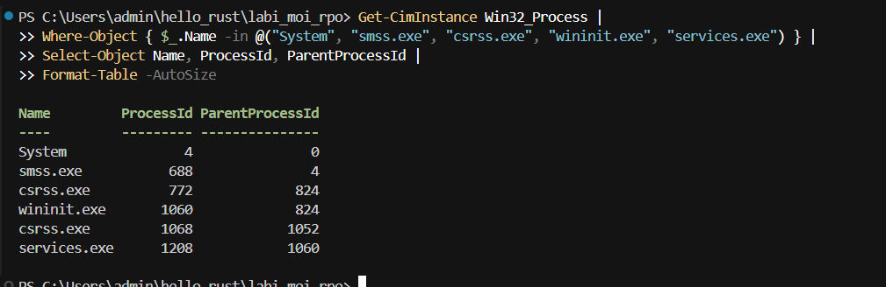
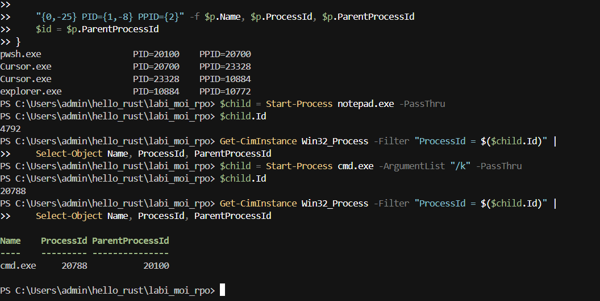
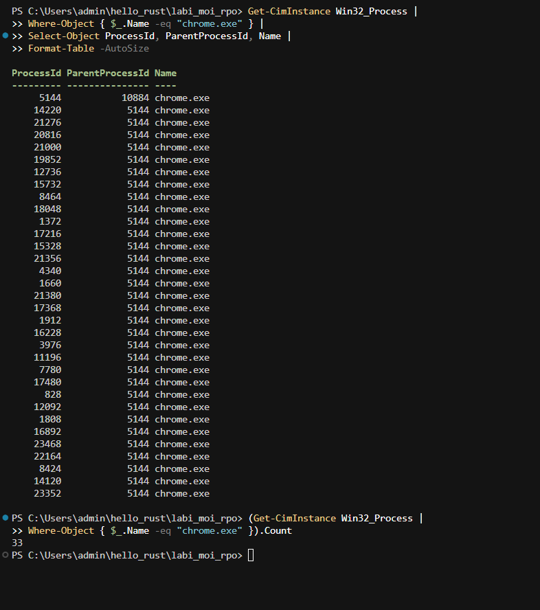
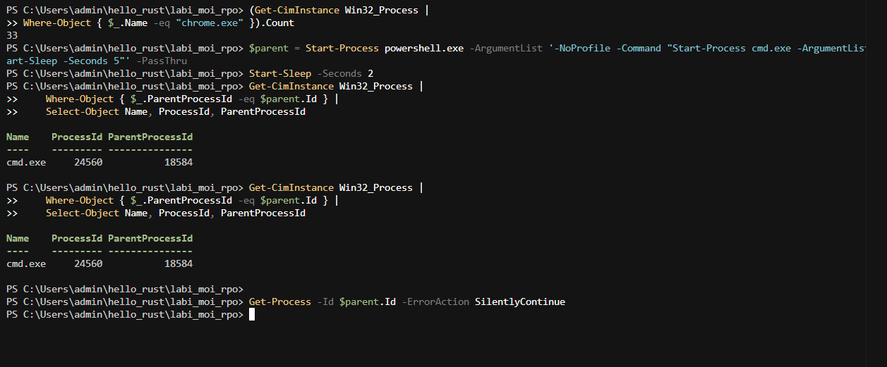

# ЛР 4. Дерево процессов

Система: ___

## Дерево
Процесс в начале дерева и его номер: ___
Цепочка родителей терминала (имя и номер): ___
Дочерний процесс: номер ___, родитель ___
Команда, которой проверен родитель: ___
Процессов у браузера и имя процесса вкладок: ___

## Сирота
Номер сироты: ___
Номер родителя до и после завершения настоящего родителя: ___
Где сирота стоит в дереве: ___

Не получилось: ___

## Реальные наблюдения PowerShell (Windows 11, 18.11.2026)

Данные взяты из двух скриншотов команд `Get-CimInstance Win32_Process`, присланных студентом.

### Системные процессы

| Процесс | PID | PPID |
|---|---:|---:|
| `System` | 4 | 0 |
| `smss.exe` | 688 | 4 |
| `csrss.exe` | 772 | 824 |
| `wininit.exe` | 1060 | 824 |
| `csrss.exe` | 1068 | 1052 |
| `services.exe` | 1208 | 1060 |

В отфильтрованном списке `System` имеет PID **4** и PPID **0**. Однако список намеренно содержит лишь несколько имён, поэтому **это не полное дерево** системы: в нём не показаны процессы с PID 824 и 1052. Отдельные PPID могут принадлежать уже завершившимся процессам.

### Цепочка родителей терминала Cursor

Вывод цикла от `$PID` через `ParentProcessId`:

```text
pwsh.exe       PID=20100  PPID=20700
Cursor.exe     PID=20700  PPID=23328
Cursor.exe     PID=23328  PPID=10884
explorer.exe   PID=10884  PPID=10772
```

Таким образом, непосредственно создавший текущий PowerShell процесс — **Cursor.exe (PID 20700)**. Над ним обнаружен ещё один Cursor.exe (PID 23328) и Windows Explorer (PID 10884). Следующий родитель PID 10772 не был найден на момент команды, поэтому цепочка вывода остановилась; это **не означает**, что Explorer является самым первым системным процессом.

Оба снимка подтверждают указанные результаты; сами PNG ещё находятся в переписке и пока не помещены в `screenshots/` GitHub.

## Объяснение и инструкция к измерениям (Windows 11)

Для задания необходимо увидеть **дерево реальных процессов** и смену родителя у процесса-сироты. На Windows основными инструментами являются Process Explorer, Диспетчер задач и PowerShell.

В PowerShell для конкретного PID:
```powershell
Get-CimInstance Win32_Process -Filter "ProcessId = 1234" |
    Select-Object ProcessId, ParentProcessId, Name
```
Замените 1234 на текущий PID. `ParentProcessId` показывает PID создавшего процесса, но после его завершения запись родителя может оказаться неактуальной; перенос сирот к PID 1 как в Unix на Windows **не происходит**. Поэтому нельзя автоматически переносить Unix-объяснение сиротства на Windows.

**Не проводилось в Windows 11:** наблюдение цепочки процессов терминала, списка процессов браузера и поведения сироты. Эти измерения и 7 настоящих снимков остаются обязательными.

## Снимки экрана

Сохраните снимок поверх заглушки в папке `screenshots/` с тем же именем — ссылки ниже менять не нужно.

### 1. Начало дерева процессов
Шаг 1. Видно: дерево процессов в мониторе: первые процессы системы и их номера.



### 2. Терминал и его родители
Шаг 2. Видно: ветка дерева от процесса терминала вверх до процесса системы.


### 3. Дочерний процесс терминала
Шаг 3. Видно: запущенный из терминала процесс под оболочкой терминала.



### 4. Родитель по команде
Шаг 4. Видно: вывод команды с номером процесса и номером его родителя.


### 5. Процессы браузера
Шаг 5. Видно: раскрытая ветка браузера с дочерними процессами.



### 6. Процесс без родителя
Шаг 6. Видно: команда запуска и номер родителя у оставшегося процесса.



### 7. Сирота в дереве
Шаг 7. Видно: тот же процесс в дереве монитора на новом месте.


