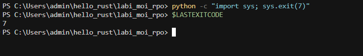
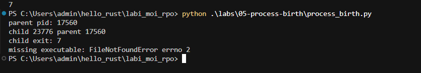

# ЛР 5. Рождение процесса

Система: ___
Программа записи: ___

## Рождение
Родитель (имя и номер): ___
Номер нового процесса: ___
Событие или вызов, которым создан процесс: ___
Библиотек загружено и первая из них: ___

## Завершение
Код завершения у ребёнка и у родителя: ___
Программа nosuch: папок проверено ___, ошибка ___, код ___

## Запуск из Python
Номер Python и номер ребёнка: ___
Чем запуск из Python отличается от запуска из оболочки: ___

Не получилось: ___

## Наблюдение запуска hostname.exe на Windows 11

Источник: реальный скриншот Microsoft Process Monitor, предоставленный студентом.

| Показатель | Результат |
|---|---|
| Родитель | `pwsh.exe`, **PID 20100** |
| Дочерняя программа | `C:\\Windows\\System32\\hostname.exe` |
| PID ребёнка | **6712** |
| Событие создания | `Process Create`, **SUCCESS** |
| Событие запуска | `Process Start`, **SUCCESS**, `Parent PID: 20100` |
| Загрузка библиотек | `Load Image` |

В списке событий `hostname.exe` отображены загрузки `ntdll.dll`, `kernel32.dll`, `KernelBase.dll`, `msvcrt.dll`, `ws2_32.dll`, `ucrtbase.dll`, `rpcrt4.dll` и другие. Первой *видимой DLL* в последовательности снимка является `ntdll.dll` (перед ней показан `HOSTNAME.EXE`). Полное число библиотек пока не подсчитано: список на скриншоте обрезан и прокручивается.

Кадр подходит для `01_birth.png` и частично для `02_libraries.png`; исходный PNG пока приложен в переписке, а не к папке `screenshots/` GitHub.

## Объяснение и инструкция к измерениям (Windows 11)

В Windows создание нового процесса обычно связано с `CreateProcess`, а процесс можно отслеживать через **Process Monitor** по событиям *Process Create* и *Process Exit*. Для DLL используются *Load Image*. В Linux аналогичные действия видны в `strace`, но это другой инструмент и другой механизм.

Дополнительная программа `process_birth.py` демонстрирует `subprocess.Popen`: дочерний Python печатает PID/PPID и завершает работу с кодом **7**, а родитель читает этот код через `wait()`. Для отсутствующей программы ожидается `FileNotFoundError`; точный Windows-код ошибки и число просмотренных папок `PATH` следует взять из реального запуска.

**Не проводилось в Windows 11:** трассировка запуска `hostname` в Process Monitor, имена реально загруженных DLL, последовательность попыток поиска `nosuch`, а также 5 скриншотов.

## Снимки экрана

Сохраните снимок поверх заглушки в папке `screenshots/` с тем же именем — ссылки ниже менять не нужно.

### 1. Рождение процесса
Шаг 1. Видно: запись запуска `hostname`: родитель создаёт процесс, у нового процесса номер родителя.

### 2. Библиотеки нового процесса
Шаг 2. Видно: библиотеки, которые загрузил `hostname`, и первая из них.

### 3. Код завершения 7
Шаг 3. Видно: завершение ребёнка с кодом 7 и тот же код у родителя.

### 4. Программы нет
Шаг 4. Видно: поиск `nosuch` по папкам из PATH и ошибка «не найдено».

### 5. Запуск из Python
Шаг 5. Видно: Python создаёт процесс `hostname`: номер Python и номер ребёнка.

