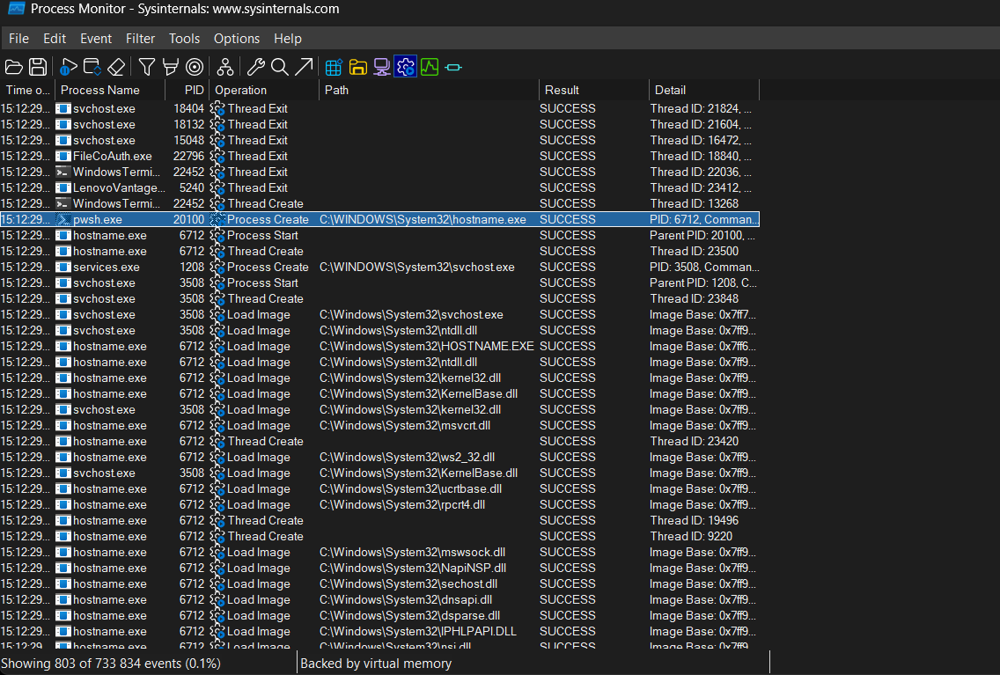

# ЛР 5. Рождение процесса

Система: **Windows 11 x64**. Программа наблюдения: **Microsoft Sysinternals Process Monitor (Procmon)**, PowerShell и Python.

## Рождение
Родитель: **pwsh.exe PID 20100**. Новый процесс: **hostname.exe PID 6712**.
События: **Process Create** (у родителя) и **Process Start** (у ребёнка), оба **SUCCESS**.
В видимой части последовательности Load Image первая DLL — **ntdll.dll**; также показаны **kernel32.dll, KernelBase.dll, msvcrt.dll, ws2_32.dll, ucrtbase.dll**. Полное число DLL **не подсчитано**.

## Завершение
`hostname.exe`: событие **Process Exit**, Exit Status **0**; User Time **0,03125 с**, Working Set **7 290 880 байт**.
Отдельный Python с `sys.exit(7)` завершился с кодом **7**, который PowerShell вывел через `$LASTEXITCODE`.
Попытка запуска отсутствующего файла из Python: **FileNotFoundError, errno 2**. Количество проверенных каталогов PATH **не измерено**; код завершения несуществующей программы отсутствует, потому что процесс не был создан.

## Запуск из Python
Родительский Python: **PID 17560**, ребёнок: **PID 23776**, PPID ребёнка **17560**, полученный родителем код завершения **7**.
Различие: `subprocess` запускает и ожидает дочерний процесс непосредственно из Python и позволяет обработать `FileNotFoundError`; при запуске из PowerShell статус читался через `$LASTEXITCODE`.

Не получилось / замечания: полный счёт DLL и число просмотренных папок PATH не измерялись; журнал событий Windows как отдельный источник не просматривали.

## Статус подтверждений

Данные разделов выше получены на Windows 11 студента, если прямо не обозначено CI. Результаты CI на Windows Server 2025 приведены отдельно и не заменяют локальные наблюдения. Некоторые кадры в `screenshots/` могут быть повторными или неполными; наличие файла не означает, что все требования экспериментально выполнены. Отсутствующие измерения обозначены явно.

## Наблюдение запуска hostname.exe на Windows 11

Источник: реальный скриншот Microsoft Process Monitor, предоставленный студентом.

| Показатель | Результат |
|---|---|
| Родитель | `pwsh.exe`, **PID 20100** |
| Дочерняя программа | `C:\\Windows\\System32\\hostname.exe` |
| PID ребёнка | **6712** |
| Событие создания | `Process Create`, **SUCCESS** |
| Событие запуска | `Process Start`, **SUCCESS**, `Parent PID: 20100` |
| Загрузка библиотек | `Load Image` |

В списке событий `hostname.exe` отображены загрузки `ntdll.dll`, `kernel32.dll`, `KernelBase.dll`, `msvcrt.dll`, `ws2_32.dll`, `ucrtbase.dll`, `rpcrt4.dll` и другие. Первой *видимой DLL* в последовательности снимка является `ntdll.dll` (перед ней показан `HOSTNAME.EXE`). Полное число библиотек пока не подсчитано: список на скриншоте обрезан и прокручивается.


## Код завершения Python (реальное наблюдение Windows 11)

На скриншоте терминала Cursor студент выполнил:

```powershell
python -c "import sys; sys.exit(7)"
$LASTEXITCODE
```

PowerShell вывел **7**. Это подтверждает, что запущенный из PowerShell Python завершился с кодом 7, а оболочка получила и отобразила этот код. **Отдельный сценарий получения статуса дочернего процесса родительским Python** впоследствии подтверждён запуском `process_birth.py` (см. следующий раздел). 
## Реальный запуск дочернего процесса из Python (Windows 11)

По скриншоту терминала Cursor студент выполнил `python .\\labs\\05-process-birth\\process_birth.py` и получил:

```text
parent pid: 17560
child 23776 parent 17560
child exit: 7
missing executable: FileNotFoundError errno 2
```

| Показатель | Фактическое значение |
|---|---|
| PID родительского Python | **17560** |
| PID дочернего Python | **23776** |
| PPID дочернего Python | **17560** |
| Код завершения дочернего процесса, полученный родителем | **7** |
| Тип исключения для несуществующего исполняемого файла | `FileNotFoundError` |
| Номер ошибки | **2** |

Это прямое подтверждение создания процесса через `subprocess.Popen`, ожидания окончания через `wait()` и обработки исключения отсутствующей программы. Код ошибки `2` соответствует ситуации «файл не найден» в данном запуске, но **число просмотренных каталогов PATH не измерено**. 
## Завершение hostname.exe в Process Monitor (Windows 11)

Источник: скриншот окна **Event Properties → Event**, предоставленный студентом, для процесса `hostname.exe` с PID **6712** (18.11.2026, время записи 15:12:29.9025699).

| Поле | Наблюдение |
|---|---|
| Operation | `Process Exit` |
| Result | `SUCCESS` |
| Exit Status | **0** |
| User Time | **0.0312500 s** |
| Kernel Time | **0.0000000 s** |
| Private Bytes | **1 150 976 bytes** |
| Peak Private Bytes | **1 150 976 bytes** |
| Working Set | **7 290 880 bytes** |
| Peak Working Set | **7 290 880 bytes** |

Это успешное завершение `hostname.exe` с кодом **0**, отличное от специально заданного кода **7** в опыте с дочерним Python. Поле `Duration: 0.0000000` в карточке события не является полной длительностью существования программы. 
## Объяснение и инструкция к измерениям (Windows 11)

В Windows создание нового процесса обычно связано с `CreateProcess`, а процесс можно отслеживать через **Process Monitor** по событиям *Process Create* и *Process Exit*. Для DLL используются *Load Image*. В Linux аналогичные действия видны в `strace`, но это другой инструмент и другой механизм.

Дополнительная программа `process_birth.py` демонстрирует `subprocess.Popen`: дочерний Python печатает PID/PPID и завершает работу с кодом **7**, а родитель читает этот код через `wait()`. Для отсутствующей программы ожидается `FileNotFoundError`; точный Windows-код ошибки и число просмотренных папок `PATH` следует взять из реального запуска.


## Снимки экрана

Сохраните снимок поверх заглушки в папке `screenshots/` с тем же именем — ссылки ниже менять не нужно.

### 1. Рождение процесса
Шаг 1. Видно: запись запуска `hostname`: родитель создаёт процесс, у нового процесса номер родителя.



### 2. Библиотеки нового процесса
Шаг 2. Видно: библиотеки, которые загрузил `hostname`, и первая из них.


### 3. Код завершения 7
Шаг 3. Видно: завершение ребёнка с кодом 7 и тот же код у родителя.


### 4. Программы нет
Шаг 4. Видно: поиск `nosuch` по папкам из PATH и ошибка «не найдено».


### 5. Запуск из Python
Шаг 5. Видно: Python создаёт процесс `hostname`: номер Python и номер ребёнка.


