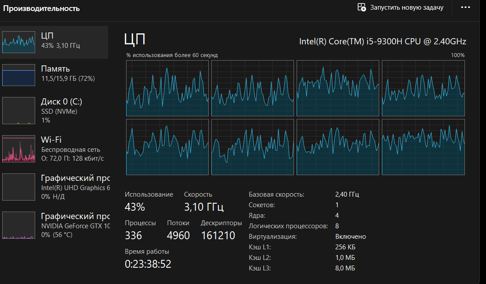
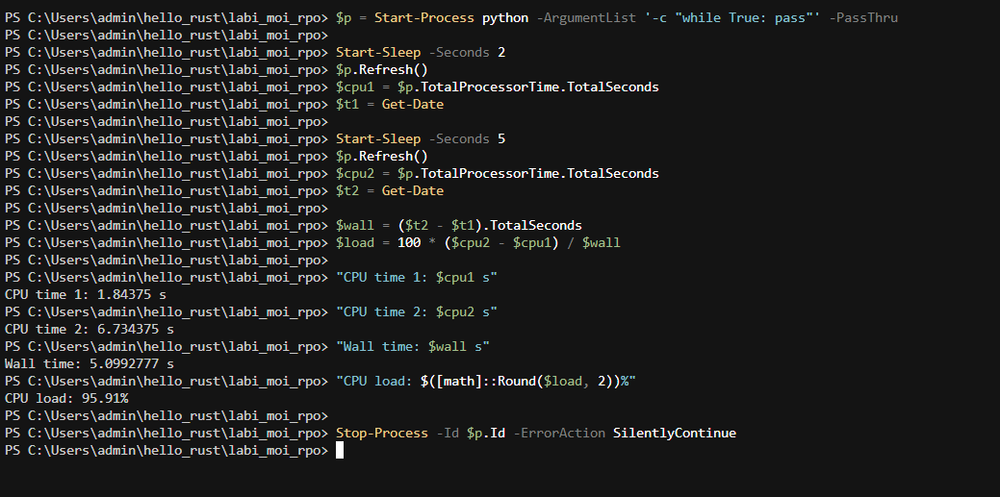

# ЛР 6. Кто загружает процессор

Система: **Windows 11 x64**, Intel Core i5-9300H, **4 физических ядра / 8 логических процессоров**.

## Одна нагрузка
`cpu_load.py`: **PID 21880**, CPU time **1,594 с**, wall **2,000 с**, расчётная загрузка одного ядра **79,7%**.
Диспетчер задач на отдельном кадре показывал **19% общей загрузки**, но кадр не связывает её однозначно с PID Python.
На восьми графиках видна нагрузка на нескольких логических процессорах; точная привязка одного процесса к ядру на этом снимке не доказана.

## Две нагрузки
`cpu_load.py`: PID **5092: 73,4% одного ядра**; PID **21796: 82,8% одного ядра** (по CPU/wall).
В отдельном эксперименте Диспетчер задач показал: Python PID **21732 — 13%**, PID **23540 — 10%**; общая загрузка CPU **43%**, включая остальные процессы.
При установке `ProcessorAffinity = 1` подтверждены два процесса **PID 21776 и 23136**, маска affinity **1** (CPU 0). Процент каждого во время закрепления не измерялся.

## Процессорное время
Первый замер: **1,84375 с**, второй: **6,734375 с**, интервал wall **5,0992777 с**.
По формуле `100 * (6,734375 − 1,84375) / 5,0992777`: **95,91% одного логического процессора**.
Процент загрузки показывает долю времени, в течение которой процесс исполнялся, но не число выполненных полезных операций: скорость зависит от частоты, IPC, планировщика, типа инструкций и фоновой нагрузки.

Не получилось / замечания: нет измерений загрузки двух процессов именно во время закрепления affinity на одном ядре; на снимках Task Manager Python-процессы показаны отдельно.

## Статус подтверждений

Данные разделов выше получены на Windows 11 студента, если прямо не обозначено CI. Результаты CI на Windows Server 2025 приведены отдельно и не заменяют локальные наблюдения. Некоторые кадры в `screenshots/` могут быть повторными или неполными; наличие файла не означает, что все требования экспериментально выполнены. Отсутствующие измерения обозначены явно.

## Фактические измерения Windows 11 — один и два процесса

Источник: скриншот PowerShell в Cursor, предоставленный студентом. Команды:

```powershell
(Get-CimInstance Win32_ComputerSystem).NumberOfLogicalProcessors
python .\\labs\\06-cpu-load\\cpu_load.py
```

Количество логических процессоров: **8**.

| Режим | PID | CPU time | Wall time | CPU/Wall | Итерации |
|---|---:|---:|---:|---:|---:|
| Один процесс | 21880 | 1.594 с | 2.000 с | **79.7%** | 3 740 992 |
| Два процесса: 1 | 5092 | 1.469 с | 2.000 с | **73.4%** | 3 552 173 |
| Два процесса: 2 | 21796 | 1.656 с | 2.000 с | **82.8%** | 3 547 358 |

Проценты выведены самим скриптом как `100 * process_time / wall_time`, **в долях одного логического процессора**, а не общего CPU в Диспетчере задач. В данном опыте при двух процессах суммарно получено примерно **156.2% одного ядра**, но это отдельный опыт: показания Диспетчера задач были получены позже и не относятся к тем же PID. Измерения зависят от частоты процессора, планировщика ОС и фоновой нагрузки; эти проценты не являются непосредственной мерой скорости процессора. 
## Наблюдение Диспетчера задач Windows 11 — графики CPU

По присланному студентом скриншоту вкладки **Производительность → ЦП** Диспетчера задач:

| Показатель | Наблюдаемое значение |
|---|---|
| CPU | Intel Core i5-9300H @ 2.40 GHz |
| Физические ядра | **4** |
| Логические процессоры | **8** |
| Общая загрузка | **19%** |
| Текущая частота | **3.99 GHz** |
| Базовая частота | **2.40 GHz** |
| Процессы | **326** |
| Потоки | **4848** |

Показаны восемь графиков загрузки логических процессоров за последние 60 секунд; активность видна на нескольких графиках. На этом 
## Две нагрузки: скриншоты Диспетчера задач Windows 11

По трём скриншотам пользователя из эксперимента с двумя отдельными процессами Python:

| Показатель | Наблюдение |
|---|---:|
| `python3.12.exe` — первый процесс | PID **21732**, CPU **13%** |
| `python3.12.exe` — второй процесс | PID **23540**, CPU **10%** |
| Общая загрузка процессора (кадр «Производительность») | **43%** |
| Частота в момент снимка | **3,10 ГГц** |
| Логических процессоров | **8** |

Значения **13%** и **10%** взяты со столбца «ЦП» Диспетчера задач, в отличие от предыдущих показателей скрипта `cpu_load.py`, рассчитанных относительно одного логического процессора. **43%** включает прочие процессы и не равно сумме двух показателей. Два процесса представлены на отдельных снимках, поэтому для строго одновременного сравнения желательно сделать один кадр, показывающий обе строки. Привязка двух процессов к одному ядру и два замера CPU time подтверждены отдельными последующими экспериментами; проценты при affinity не снимались. 
## Привязка двух процессов к одному логическому процессору (Windows 11)

Источник: скриншот PowerShell в Cursor, предоставленный студентом после вызова `Start-Process python ... -PassThru` и установки `$p.ProcessorAffinity = 1` для двух процессов.

| Процесс | PID | ProcessorAffinity |
|---|---:|---:|
| Python №1 | **21776** | **1** |
| Python №2 | **23136** | **1** |

В битовой маске affinity значение `1` разрешает выполнение на логическом процессоре **CPU 0**. Таким образом, оба процесса ограничены одним и тем же логическим процессором. Измерения их фактических процентов CPU во время этого ограничения **ещё не предоставлены**, поэтому нельзя утверждать, как именно они разделили время. Процессы запускались с ограниченным временем около 30 секунд. 
## Два замера CPU time на Windows 11 (реальный эксперимент)

Источник: скриншот терминала Cursor с командами PowerShell `Start-Process python`, `$p.Refresh()`, двумя измерениями `$p.TotalProcessorTime.TotalSeconds`, паузой `Start-Sleep -Seconds 5` и расчётом процента.

| Показатель | Измерено |
|---|---:|
| CPU time 1 | **1.84375 с** |
| CPU time 2 | **6.734375 с** |
| Wall time | **5.0992777 с** |
| Прирост CPU time | **4.890625 с** |
| CPU load = 100 × ΔCPU / Δwall | **95.91%** |

Проверка: `100 × (6.734375 − 1.84375) / 5.0992777 ≈ 95.91%`. Это **процент одного логического процессора**, а не загрузка всех восьми логических процессоров машины. По окончании измерений выполнено `Stop-Process -Id $p.Id -ErrorAction SilentlyContinue`; команда не выдала ошибку. 
## Объяснение расчётов (Windows 11)

Для вычисления загрузки отдельного процесса по двум замерам используют:

```text
CPU% одного ядра = 100 * (CPU_time_2 - CPU_time_1) / (wall_time_2 - wall_time_1)
```

В Диспетчере задач Windows часто используется другой масштаб: загрузка от **общей мощности всех логических процессоров**, поэтому полная нагрузка одного ядра при N логических процессорах составляет примерно `100/N %` общей загрузки, без учёта остальных процессов.

В проекте есть `cpu_load.py`: он создаёт одну и две нагрузки, вычисляет CPU time и wall time и выводит проценты на одно ядро. Эти данные **нельзя** выдавать за показания Диспетчера задач, пока запуск на Windows 11 не сделан.


## Снимки экрана

Сохраните снимок поверх заглушки в папке `screenshots/` с тем же именем — ссылки ниже менять не нужно.

### 1. Одна нагрузка
Шаг 1. Видно: процесс Python в мониторе: его процент и общая загрузка.


### 2. Две нагрузки
Шаг 3. Видно: два процесса Python и загрузка ядер.



### 3. Нагрузки на одном ядре
Шаг 4. Видно: две нагрузки на одном ядре и их проценты; в macOS — два числа оборотов цикла.


### 4. Процессорное время
Шаг 5. Видно: два замера процессорного времени с паузой между ними.


