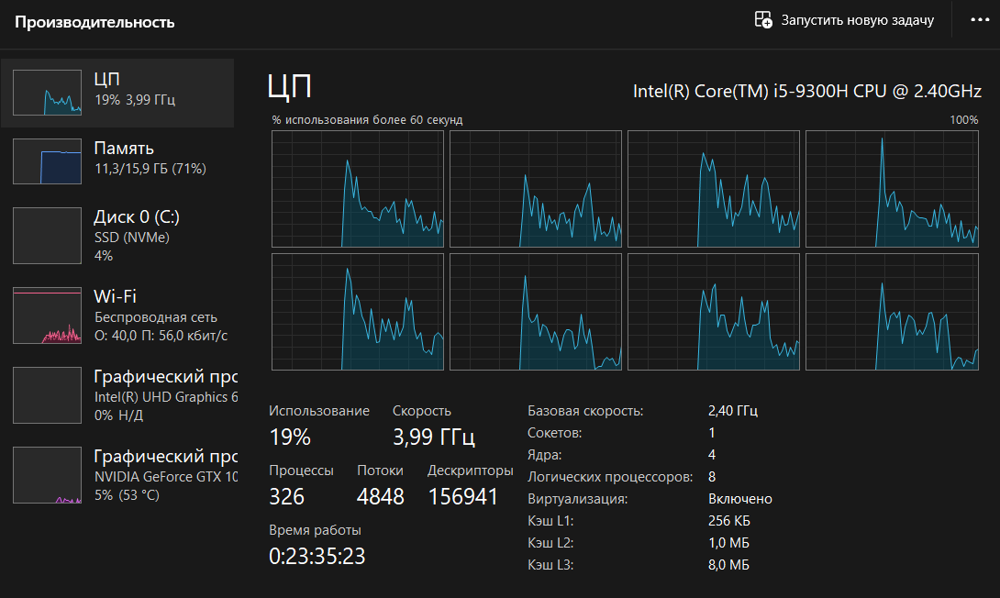
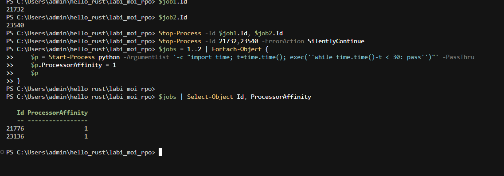

# ЛР 6. Кто загружает процессор

Система: ___
Ядер (логических процессоров): ___

## Одна нагрузка
Процент процесса в мониторе: ___
Общая загрузка: ___
На каких ядрах видна нагрузка: ___

## Две нагрузки
Проценты обеих нагрузок и общая загрузка: ___
На одном ядре (в macOS — фоновый режим): ___

## Процессорное время
Первый замер, второй замер, пауза: ___
Загрузка по замерам: ___
Почему процент в мониторе не говорит о скорости работы: ___

Не получилось: ___

## Фактические измерения Windows 11 — один и два процесса

Источник: скриншот PowerShell в Cursor, предоставленный студентом. Команды:

```powershell
(Get-CimInstance Win32_ComputerSystem).NumberOfLogicalProcessors
python .\\labs\\06-cpu-load\\cpu_load.py
```

Количество логических процессоров: **8**.

| Режим | PID | CPU time | Wall time | CPU/Wall | Итерации |
|---|---:|---:|---:|---:|---:|
| Один процесс | 21880 | 1.594 с | 2.000 с | **79.7%** | 3 740 992 |
| Два процесса: 1 | 5092 | 1.469 с | 2.000 с | **73.4%** | 3 552 173 |
| Два процесса: 2 | 21796 | 1.656 с | 2.000 с | **82.8%** | 3 547 358 |

Проценты выведены самим скриптом как `100 * process_time / wall_time`, **в долях одного логического процессора**, а не общего CPU в Диспетчере задач. В данном опыте при двух процессах суммарно получено примерно **156.2% одного ядра**, но показания Диспетчера задач и распределение по ядрам **пока не измерены**. Измерения зависят от частоты процессора, планировщика ОС и фоновой нагрузки; эти проценты не являются непосредственной мерой скорости процессора. Скриншот пока в переписке, его необходимо добавить в `screenshots/` GitHub.

## Наблюдение Диспетчера задач Windows 11 — графики CPU

По присланному студентом скриншоту вкладки **Производительность → ЦП** Диспетчера задач:

| Показатель | Наблюдаемое значение |
|---|---|
| CPU | Intel Core i5-9300H @ 2.40 GHz |
| Физические ядра | **4** |
| Логические процессоры | **8** |
| Общая загрузка | **19%** |
| Текущая частота | **3.99 GHz** |
| Базовая частота | **2.40 GHz** |
| Процессы | **326** |
| Потоки | **4848** |

Показаны восемь графиков загрузки логических процессоров за последние 60 секунд; активность видна на нескольких графиках. На этом скриншоте **нет PID Python и списка процессов**, поэтому нельзя однозначно приписать нагрузку конкретному исполняемому процессу. Кадр подходит для демонстрации загрузки CPU, но для строгого доказательства *одной Python-нагрузки* его следует дополнить снимком процесса Python с PID и CPU. Изображение ещё находится в переписке, не в `screenshots/` GitHub.

## Объяснение расчётов (Windows 11)

Для вычисления загрузки отдельного процесса по двум замерам используют:

```text
CPU% одного ядра = 100 * (CPU_time_2 - CPU_time_1) / (wall_time_2 - wall_time_1)
```

В Диспетчере задач Windows часто используется другой масштаб: загрузка от **общей мощности всех логических процессоров**, поэтому полная нагрузка одного ядра при N логических процессорах составляет примерно `100/N %` общей загрузки, без учёта остальных процессов.

В проекте есть `cpu_load.py`: он создаёт одну и две нагрузки, вычисляет CPU time и wall time и выводит проценты на одно ядро. Эти данные **нельзя** выдавать за показания Диспетчера задач, пока запуск на Windows 11 не сделан.

**Не измерено на Windows 11:** фактическое количество логических процессоров, распределение нагрузки по ядрам, CPU time процесса и результаты закрепления двух нагрузок на одном ядре; нужно 4 снимка.

## Снимки экрана

Сохраните снимок поверх заглушки в папке `screenshots/` с тем же именем — ссылки ниже менять не нужно.

### 1. Одна нагрузка
Шаг 1. Видно: процесс Python в мониторе: его процент и общая загрузка.



### 2. Две нагрузки
Шаг 3. Видно: два процесса Python и загрузка ядер.


### 3. Нагрузки на одном ядре
Шаг 4. Видно: две нагрузки на одном ядре и их проценты; в macOS — два числа оборотов цикла.



### 4. Процессорное время
Шаг 5. Видно: два замера процессорного времени с паузой между ними.


