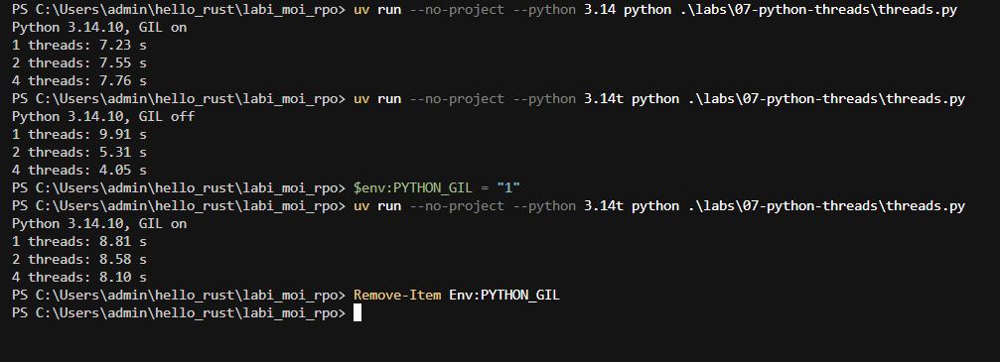

# ЛР 7. Потоки Python и GIL

Система: **Windows 11 x64**, **8 логических процессоров**. Python **3.14.10** (стандартный, GIL=True) и **3.14.10t** (free-threaded, GIL=False), установка через uv.

## Python с GIL
Четыре вычислительных потока `spin.py`: в Диспетчере задач **PID 24124, CPU 12%**, память **6 116 КБ** (название столбца на кадре сокращено).
При включённом GIL только один поток одновременно исполняет Python-байткод данного интерпретатора; фактическое число потоков и их состояния в Process Explorer **не измерены**.

## Python без GIL
`spin.py`: **PID 21568, CPU 48%**, память **10 060 КБ**. Загрузка примерно **вчетверо выше** наблюдённых 12%, что согласуется с исполнением CPU-bound кода на нескольких ядрах. Проценты отдельных потоков **не измерялись**.

## Время работы
Обычный Python 3.14 (GIL on), 1/2/4 потока: **7,23 / 7,55 / 7,76 с**.
Free-threaded Python 3.14t (GIL off), 1/2/4 потока: **9,91 / 5,31 / 4,05 с**.
Free-threaded Python 3.14t с `PYTHON_GIL=1`: **8,81 / 8,58 / 8,10 с**.
Ожидание `time.sleep(2)`: **2,00 с** для 1 и для 4 потоков в обеих сборках. Во время сна поток не занимает CPU выполнением байткода и освобождает GIL, поэтому ожидания перекрываются.
Ускорение 3.14t без GIL при 4 потоках относительно 1 потока той же сборки: **9,91 / 4,05 ≈ 2,45 раза**.

Не получилось / замечания: отсутствует отдельный `02_threads.png` со списком потоков; индивидуальные проценты и состояния потоков не измерены.

## Статус подтверждений

Данные разделов выше получены на Windows 11 студента, если прямо не обозначено CI. Результаты CI на Windows Server 2025 приведены отдельно и не заменяют локальные наблюдения. Некоторые кадры в `screenshots/` могут быть повторными или неполными; наличие файла не означает, что все требования экспериментально выполнены. Отсутствующие измерения обозначены явно.

## Проверка двух сборок Python на Windows 11

По предоставленному студентом скриншоту терминала Cursor после установки через `uv python install 3.14 3.14t`:

| Параметр | Обычная сборка | Free-threaded сборка |
|---|---|---|
| Версия | **3.14.10** | **3.14.10** |
| Архитектура | AMD64 | AMD64 |
| `sys._is_gil_enabled()` | **True** | **False** |
| Запуск | `uv run --no-project --python 3.14 python` | `uv run --no-project --python 3.14t python` |

## Реальное наблюдение четырёх потоков с GIL (Windows 11)

Источник: скриншот Диспетчера задач Windows 11, вкладка «Подробности», предоставленный студентом после запуска `spin.py` на стандартном Python 3.14.

| Показатель | Измеренное значение |
|---|---|
| Процесс | `python.exe` |
| PID | **24124** |
| CPU в Диспетчере задач | **12%** |
| Память (название столбца на снимке сокращено) | **6 116 КБ** |
| Архитектура | **x64** |
| Состояние | Выполняется |

На компьютере **8 логических процессоров**, поэтому полная загрузка одного логического процессора ориентировочно соответствует `100 / 8 = 12.5%` общей загрузки. Наблюдённые 12% согласуются с ожиданием при обычном Python с GIL и вычислительных потоках, но **сам снимок не доказывает, что все четыре потока существуют или сколько из них одновременно исполняют Python-код**. Это требует отдельного наблюдения Threads. 
## Реальный эксперимент free-threaded Python без GIL (Windows 11)

Источник: скриншот Диспетчера задач Windows 11, вкладка «Подробности», после запуска `spin.py` на Python 3.14t. Ранее в терминале подтверждено `sys._is_gil_enabled() = False` для Python 3.14.10t.

| Параметр | Python с GIL | Python без GIL |
|---|---:|---:|
| Версия | 3.14.10 | 3.14.10 free-threaded |
| PID | **24124** | **21568** |
| CPU в Диспетчере задач | **12%** | **48%** |
| Память (название столбца сокращено на снимке) | **6 116 КБ** | **10 060 КБ** |
| Архитектура | x64 | x64 |

## Реальные измерения threads.py (Windows 11, Python 3.14.10)

Источник: скриншот терминала Cursor с тремя последовательными запусками `labs/07-python-threads/threads.py` через `uv run --no-project`.

| Режим | 1 поток | 2 потока | 4 потока |
|---|---:|---:|---:|
| Обычный Python 3.14, GIL on | **7.23 с** | **7.55 с** | **7.76 с** |
| Python 3.14t, GIL off | **9.91 с** | **5.31 с** | **4.05 с** |
| Python 3.14t, `PYTHON_GIL=1` | **8.81 с** | **8.58 с** | **8.10 с** |

Время измеряется `time.perf_counter()`; суммарная работа фиксирована: `N = 200_000_000` итераций, разделённых поровну между потоками.

- **Обычная сборка с GIL:** добавление потоков не дало ускорения для CPU-bound цикла: время изменилось с 7.23 с до 7.76 с.
- **Free-threaded сборка:** 4 потока дали ускорение **9.91 / 4.05 ≈ 2.45 раза** относительно одного потока той же сборки, но не идеальные 4 раза.
- **Free-threaded с принудительным GIL:** 1/2/4 потока заняли 8.81/8.58/8.10 с; устойчивого масштабирования, аналогичного GIL off, нет.
- **Разные сборки:** режим 1 потока в 3.14t (9.91 с) медленнее стандартного 3.14 (7.23 с); нельзя сравнивать только абсолютное время 4 потоков, игнорируя базовую производительность сборок.

## Эксперимент ожидающих потоков (Windows 11, реальные измерения)

По скриншоту терминала Cursor студент выполнил `wait.py` на обеих версиях Python 3.14.10:

| Сборка | 1 поток (sleep 2 s) | 4 потока (sleep 2 s) |
|---|---:|---:|
| Обычная Python 3.14, GIL on | **2.00 с** | **2.00 с** |
| Python 3.14t, GIL off | **2.00 с** | **2.00 с** |

Эксперимент показывает, что ожидающие потоки `time.sleep(2)` выполняют ожидание параллельно, даже если GIL включён. `time.sleep` не требует непрерывного исполнения Python-байткода и освобождает GIL на время ожидания. Для этой задачи отключение GIL не принесло заметного ускорения. Это **не** означает, что четыре CPU-bound потока будут одинаково быстры в двух сборках: отдельные измерения `threads.py` дали другое поведение.

## Теоретическое объяснение и условия опыта (Windows 11)

Исходные `spin.py`, `threads.py`, `wait.py` сохранены из преподавательского шаблона. Для корректного сравнения необходимы **обычный Python 3.14** и **free-threaded Python 3.14t**: Python 3.13 из текущих GitHub Actions для этого не подходит.

- В обычной сборке с GIL CPU-bound Python-код не исполняется параллельно в нескольких потоках одного интерпретатора.
- В free-threaded сборке GIL может быть выключен, поэтому CPU-bound потоки потенциально используют несколько ядер; масштабирование зависит от реальной среды.
- `time.sleep` не занимает ядро активными вычислениями, поэтому четыре ожидающих потока могут завершиться примерно за то же время, что один (при одновременном старте).
- `PYTHON_GIL=1` позволяет сравнить режим включённого GIL в поддерживающей это сборке.

## Снимки экрана

Сохраните снимок поверх заглушки в папке `screenshots/` с тем же именем — ссылки ниже менять не нужно.

### 1. Четыре потока с GIL
Шаг 1. Видно: процесс Python в мониторе: его процент и число потоков.

### 2. Потоки процесса
Шаг 2. Видно: список потоков процесса: сколько выполняется, сколько ждёт.

### 3. Четыре потока без GIL
Шаг 3. Видно: процесс python3.14t в мониторе: его процент.

### 4. Время работы
Шаг 4. Видно: вывод threads.py в Python с GIL и без.

