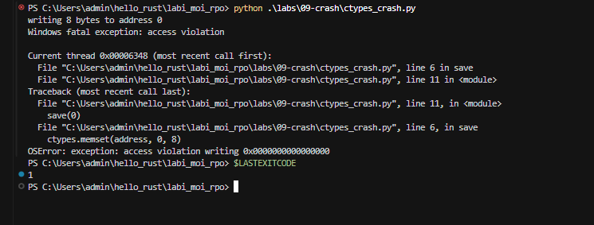

# ЛР 9. Разбор падения

Система: ___
Компилятор: ___

## Падение
crash null: что напечатано и код завершения: ___
ctypes_crash.py: что напечатал Python: ___
Где система записала падение: ___

## Молчаливые ошибки
crash overflow: limit до и после, код: ___
crash heap без проверки: ___
AddressSanitizer для heap: вид ошибки и строка: ___
AddressSanitizer для uaf: вид ошибки и две строки: ___

## Исправление
Что изменено и что напечатала исправленная программа: ___

Не получилось: ___

## Реальные результаты GCC на Windows 11 (18.11.2026)

Источник: скриншот терминала Cursor, предоставленный студентом; компиляция через GCC с `-g -O0`.

**Исправленная программа** `fixed_crash.exe` выдала:

```text
NULL write prevented
limit after fix: 100
name before free: agent
Memory errors prevented
```

После её запуска `$LASTEXITCODE` вернул **0**.

**Неисправная программа, режим overflow** `crash.exe overflow` выдала:

```text
limit before: 100
limit after:  7
```

После этого `$LASTEXITCODE` вернул **0**. В данной сборке запись за границами `data[4]` привела к повреждению поля `limit` (100 → 7), но не к аварийному завершению. Это пример **неопределённого поведения**: другой запуск, компилятор или оптимизация могут привести к иному результату. Отдельные проверки `null`, `heap`, `uaf`, `ctypes_crash.py` и AddressSanitizer на Windows **пока не проводились**. Скриншот ещё находится в переписке и не помещён в `screenshots/` GitHub.

## Реальное падение при записи по NULL (Windows 11)

Источник: скриншот PowerShell, присланный студентом после запуска `.\\labs\\09-crash\\crash.exe null`.

```text
writing to address 0000000000000000
$LASTEXITCODE
-1073741819
```

Этот код завершения соответствует Windows NTSTATUS **0xC0000005 / STATUS_ACCESS_VIOLATION** — нарушению доступа к памяти. В данном эксперименте ошибка возникла при попытке записи по нулевому указателю. Строка `not reached` не появилась. В предыдущем запуске `overflow` код завершения был 0, хотя поле `limit` повреждалось. Снимок соответствует `01_crash.png`; PNG пока находится только в чате, не в папке `screenshots/` GitHub.

## Аварийное завершение Python через ctypes (Windows 11)

Источник: скриншот терминала Cursor, предоставленный студентом после запуска `python .\\labs\\09-crash\\ctypes_crash.py` и проверки `$LASTEXITCODE`.

```text
writing 8 bytes to address 0
Windows fatal exception: access violation
File "ctypes_crash.py", line 6 in save
File "ctypes_crash.py", line 11 in <module>
$LASTEXITCODE
1
```

В трассировке **faulthandler** указан вызов `ctypes.memset(address, 0, 8)` из функции `save()` в строке **6**, вызванной из строки **11**. Реальная ошибка — нарушение доступа (access violation) при записи в нулевой адрес. PowerShell отобразил код завершения **1** для этого запуска; не следует путать его с `0xC0000005` из отдельного эксперимента `crash.exe null`. Этот кадр соответствует `02_python_crash.png`. Изображение пока находится только в переписке, не в папке `screenshots/` GitHub.

## Анализ причин и исправлений (Windows 11)

Исходный `crash.c` специально содержит четыре режима:
- `null`: запись по нулевому указателю (некорректный доступ, возможное аварийное завершение).
- `overflow`: выход за границы `data[4]`; поведение неопределено, поэтому изменение `limit` нельзя гарантировать.
- `heap`: запись пятого элемента в динамический массив из четырёх.
- `uaf`: использование указателя после `free`.

Добавлен `fixed_crash.c`: проверка `NULL`, корректные границы циклов и запрет использования освобождённой памяти. В Linux-контейнере эта исправленная программа ранее прошла проверку с ASan/UBSan; **это не запуск на Windows 11**.

Для Windows можно собирать AddressSanitizer в поддерживающем компиляторе MSVC (`/fsanitize=address`) и фиксировать *heap-buffer-overflow* и *heap-use-after-free* для соответствующих режимов. Адреса и строки из фактического вывода обязательны для отчёта.

**Не проводилось:** падение процессов в Windows, просмотр Windows Event Viewer, реальные ASan-отчёты для неисправной программы и 4 скриншота. Нельзя предсказать точный exit code для неопределённого поведения.

## Снимки экрана

Сохраните снимок поверх заглушки в папке `screenshots/` с тем же именем — ссылки ниже менять не нужно.

### 1. Падение
Шаг 1. Видно: запуск crash null и код завершения.


### 2. Падение Python
Шаг 2. Видно: вывод ctypes_crash.py и запись системы о падении.



### 3. Отчёт AddressSanitizer
Шаг 4. Видно: вывод crash heap без проверки и с AddressSanitizer (на Windows с ARM — без проверки).


### 4. Исправление
Шаг 6. Видно: разница файлов и вывод исправленной программы.


