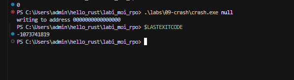
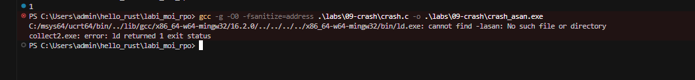
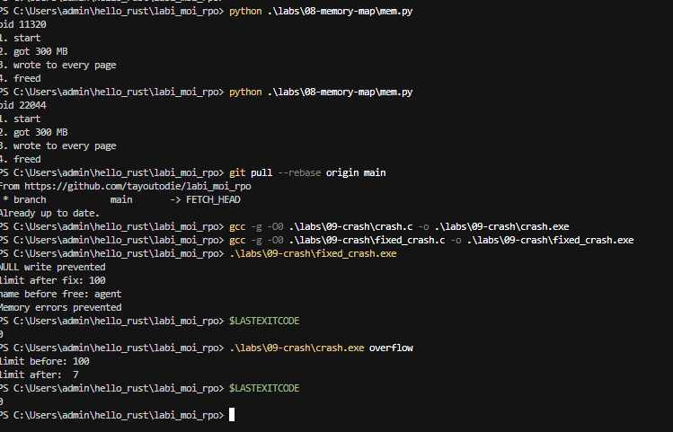

# ЛР 9. Разбор падения

Система: ___
Компилятор: ___

## Падение
crash null: что напечатано и код завершения: ___
ctypes_crash.py: что напечатал Python: ___
Где система записала падение: ___

## Молчаливые ошибки
crash overflow: limit до и после, код: ___
crash heap без проверки: ___
AddressSanitizer для heap: вид ошибки и строка: ___
AddressSanitizer для uaf: вид ошибки и две строки: ___

## Исправление
Что изменено и что напечатала исправленная программа: ___

Не получилось: ___

## Анализ причин и исправлений (Windows 11)

Исходный `crash.c` специально содержит четыре режима:
- `null`: запись по нулевому указателю (некорректный доступ, возможное аварийное завершение).
- `overflow`: выход за границы `data[4]`; поведение неопределено, поэтому изменение `limit` нельзя гарантировать.
- `heap`: запись пятого элемента в динамический массив из четырёх.
- `uaf`: использование указателя после `free`.

Добавлен `fixed_crash.c`: проверка `NULL`, корректные границы циклов и запрет использования освобождённой памяти. В Linux-контейнере эта исправленная программа ранее прошла проверку с ASan/UBSan; **это не запуск на Windows 11**.

Для Windows можно собирать AddressSanitizer в поддерживающем компиляторе MSVC (`/fsanitize=address`) и фиксировать *heap-buffer-overflow* и *heap-use-after-free* для соответствующих режимов. Адреса и строки из фактического вывода обязательны для отчёта.

**Не проводилось:** падение процессов в Windows, просмотр Windows Event Viewer, реальные ASan-отчёты для неисправной программы и 4 скриншота. Нельзя предсказать точный exit code для неопределённого поведения.

## Снимки экрана

Сохраните снимок поверх заглушки в папке `screenshots/` с тем же именем — ссылки ниже менять не нужно.

### 1. Падение
Шаг 1. Видно: запуск crash null и код завершения.

### 2. Падение Python
Шаг 2. Видно: вывод ctypes_crash.py и запись системы о падении.

### 3. Отчёт AddressSanitizer
Шаг 4. Видно: вывод crash heap без проверки и с AddressSanitizer (на Windows с ARM — без проверки).

### 4. Исправление
Шаг 6. Видно: разница файлов и вывод исправленной программы.

